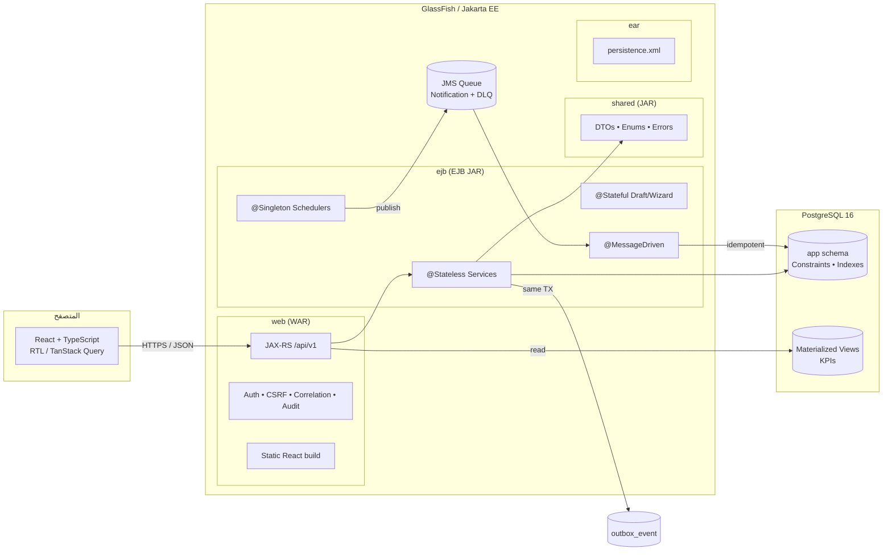

# 00 — الخطة الرئيسية (Master Plan)

> **Smart Hospital** — نظام مستشفى مؤسسي متعدد الوحدات
> **الهدف:** تحويل الفكرة إلى مشروع قابل للتشغيل والاختبار والدفاع الأكاديمي، وليس مجرد واجهات.

---

## 1. الحكم النهائي على الفكرة

**التقييم: 8.5 / 10 كفكرة مشروع مؤسسي، و6 / 10 كخطة تنفيذ جاهزة.**

الفكرة ممتازة لأنها:
- مبنية على **عمليات لها عواقب حقيقية** (دواء، نتيجة مختبر، سرير، مال)، وهذه أفضل أرضية لإثبات المعاملات والتزامن.
- تشرح **JMS** بشكل طبيعي: إشعار الطبيب بنتيجة المختبر.
- تسمح بفصل واضح بين **البيانات السريرية** و**البيانات المالية** و**الصلاحيات**.
- فيها وعي ناضج بحدود الذكاء الاصطناعي (لا تشخيص آلي).

لكنها تحتاج إلى تشديد في عشرة مواضع، أهمها: **النطاق، آلات الحالة، قيود قاعدة البيانات، التزامن، الأمان على مستوى السجل، وقابلية قياس الذكاء التشغيلي**.

---

## 2. نقاط القوة التي يجب الحفاظ عليها

| القوة | لماذا هي مهمة؟ |
|-------|----------------|
| Modular Monolith | يناسب المعاملات المترابطة ويبقي المشروع قابلاً للإنجاز |
| العمليات الأربع الحرجة | مادة خصبة لاختبار Rollback والتزامن وليس CRUD فقط |
| فصل الأدوار | يسمح بإثبات Least Privilege وليس فقط إخفاء أزرار |
| وجود طبقة ذكاء | يرفع المشروع من "نظام تسجيل" إلى "نظام دعم قرار" |
| رفض الذكاء السريري | يحمي المشروع أخلاقياً وأكاديمياً |
| وعي NFR | يميز المشروع عن مشاريع الطلاب النموذجية |

---

## 3. الفجوات الحرجة (ما ينقص الفكرة)

### 3.1 فجوات النطاق والإدارة

| # | الفجوة | الأثر | المعالجة |
|---|--------|-------|----------|
| 1 | 12 وحدة في نسخة واحدة | المشروع لا يكتمل أو يكتمل سطحيّاً | MoSCoW + نطاق MVP واضح (القسم 6) |
| 2 | لا تقدير جهد أو فريق | خطة غير واقعية | خطة 14 أسبوعاً بافتراض فريق 3 أشخاص (الملف 06) |
| 3 | لا Definition of Done | "خلصت" تعني الشاشة فقط | DoD موحد: كود + اختبار + صلاحية + تدقيق + توثيق |
| 4 | لا إدارة مخاطر | انهيار عند أول عقبة تقنية | سجل مخاطر + خطة بديلة (القسم 13) |

### 3.2 فجوات النطاق الوظيفي (Domain)

| # | الفجوة | أمثلة يجب إضافتها |
|---|--------|-------------------|
| 5 | لا **آلات حالة** | وصفة: DRAFT → PENDING → APPROVED → DISPENSED/PARTIAL/CANCELLED/EXPIRED. طلب مختبر: ORDERED → COLLECTED → RECEIVED → RESULTED → APPROVED. فاتورة: DRAFT → OPEN → PARTIALLY_PAID → PAID/VOID. تنويم: REQUESTED → ADMITTED → TRANSFERRED → DISCHARGED. |
| 6 | لا **هوية مريض** واضحة | MRN، منع التكرار (اسم + هاتف + تاريخ ميلاد + رقم وطني)، دمج سجلات، تاريخ موافقة |
| 7 | لا **سلامة دوائية** | تحقق حساسية، تفاعل دواء-دواء أساسي، تكرار علاج، جرعة خارج المدى — كتحذيرات لا قرارات |
| 8 | لا **قيمة حرجة للمختبر** | Critical values، عتبات مرجعية حسب العمر/الجنس، فصل من يدخل النتيجة عن من يعتمدها |
| 9 | لا **نموذج مالي سليم** | بنود فاتورة، لقطة سعر، خصم بموافقة، ضريبة، استرجاع، إلغاء، دفتر أستاذ مزدوج، Idempotency |
| 10 | لا **دفتر مخزون** | دفعات، FEFO، صلاحية، حركات غير قابلة للتعديل، حجز، إرجاع، جرد |
| 11 | لا **تنويم/أسرّة** بتفصيل | غرفة/سرير/إقامة/نقل/خروج، تعارض زمني، احتساب إقامة |
| 12 | لا **إلغاء/إعادة جدولة/عدم حضور** | سياسات المواعيد، قائمة انتظار، أولوية، No-show job |
| 13 | لا **مشتريات** | مورد، طلب شراء، أمر شراء، استلام، مطابقة ثلاثية (توسعي) |

### 3.3 فجوات المعمارية والموثوقية

| # | الفجوة | الأثر | المعالجة |
|---|--------|-------|----------|
| 14 | الاعتماد على Java لمنع التعارض | تعارض مواعيد/أسرّة تحت التزامن | **Exclusion Constraints** في PostgreSQL + أقفال صفية |
| 15 | لا Idempotency | دفعة مالية مكررة أو صرف مكرر عند إعادة المحاولة | `Idempotency-Key` + قيد UNIQUE |
| 16 | لا Outbox | فشل JMS يفقد الإشعار أو يربك المعاملة | Outbox + نشر دوري + مستهلك Idempotent |
| 17 | لا استراتيجية ترحيل قاعدة بيانات | سكربتات يدوية وتضارب | Flyway + سكربتات مرقمة + Seed |
| 18 | لا Observability | تشخيص بطيء و"مش عارف فين المشكلة" | Correlation ID + JSON logs + `/health` + مقاييس |
| 19 | لا CI/CD | دمج متأخر وأخطاء متكررة | GitHub Actions: بناء + اختبار + فحص |
| 20 | لا ضبط أداء JPA | N+1 واستعلامات بطيئة | DTO projections + EntityGraph + BatchSize + فهارس + قياس |

### 3.4 فجوات الأمان

| # | الفجوة | الملاحظة |
|---|--------|----------|
| 21 | "خوارزمية مخصصة لكلمات المرور" | ❌ ممنوع. استخدم **Argon2id** أو PBKDF2 قياسي، مع Salt ومعاملات مخزنة |
| 22 | الصلاحية على مستوى الشاشة | الطبيب لا يرى كل المرضى؛ الربط بالزيارة/الطلب/القسم |
| 23 | لا Break-glass | حالة الطوارئ تحتاج وصولاً مؤقتاً مبرراً ومسجلاً |
| 24 | تدقيق الكتابة فقط | يجب تدقيق **قراءة** السجل الطبي أيضاً |
| 25 | لا حماية CSRF/CSP | جلسات + SameSite + Token + رؤوس أمان |
| 26 | لا قيود على محاولات الدخول | Rate limit + قفل مؤقت + تدقيق |
| 27 | لا سياسة احتفاظ/نسخ احتياطي | Retention + تشفير نسخ + تجربة استعادة فعلية |

### 3.5 فجوات الذكاء التشغيلي

| # | الفجوة | الأثر |
|---|--------|------|
| 28 | مؤشرات بلا تعريف رياضي | رقم لا يمكن الدفاع عنه |
| 29 | لا نافذة زمنية/عينة/ثقة | تقرير مضلل |
| 30 | لا دورة حياة لبطاقة القرار | تنبيهات تتكدس ولا أحد يعالجها |
| 31 | لا قياس أثر | لا نعرف هل التوصية نجحت |
| 32 | لا بيانات اصطناعية واقعية | التحليلات فارغة أو غير مقنعة |
| 33 | لا حدود واضحة | انزلاق إلى توصيات سريرية |

---

## 4. الاقتراحات الذكية التي ترفع الجودة (مرتبة بالأثر)

### المستوى الأول — إلزامي، أثر عالٍ وتكلفة معقولة

| # | الاقتراح | لماذا يميز المشروع؟ | أين يظهر؟ |
|---|----------|---------------------|-----------|
| S1 | **Outbox Pattern + MDB Idempotent** | يثبت أن الإشعار لا يُفقد وأن النتيجة الطبية محفوظة | المختبر |
| S2 | **Exclusion Constraints** للمواعيد والأسرّة | يمنع التعارض على مستوى قاعدة البيانات وليس الثقة بالكود | المواعيد/التنويم |
| S3 | **دفتر أستاذ مالي مزدوج + Idempotency** | سلامة مالية قابلة للتوفيق وليست `UPDATE balance` | الفواتير |
| S4 | **دفتر حركات مخزون append-only + FEFO** | لا كميات سالبة ولا صرف من دفعة منتهية | الصيدلية |
| S5 | **آلات حالة صريحة** | كل انتقال مبرر ومرفوض بوضوح | كل العمليات |
| S6 | **سجل تدقيق بسلسلة Hash** | Tamper-evident، قابل للتحقق أمام اللجنة | التدقيق |
| S7 | **ABAC + Break-glass + تدقيق القراءة** | صلاحيات واقعية للمستشفى وليست أزراراً | الأمان |
| S8 | **KPI Dictionary + Decision Cards بدورة حياة** | "ذكاء" قابل للقياس والتفسير | الإدارة |
| S9 | **مولد بيانات اصطناعية 12 شهراً + إعادة ضبط** | تحليلات ذات معنى وعرض مضمون | التحليلات/العرض |
| S10 | **OpenAPI + توليد عميل TypeScript** | عقد API واحد يمنع انحراف الواجهة | الفريق |

### المستوى الثاني — تميّز أكاديمي

| # | الاقتراح | الأثر |
|---|----------|-------|
| S11 | **قواعد سلامة دوائية** (حساسية/تفاعل/تكرار) بتحذير وإقرار سبب | يثبت فهم سلامة المريض |
| S12 | **Critical Lab Values + فصل الاعتماد** | جودة مختبر حقيقية |
| S13 | **TAT Waterfall للمختبر** (طلب→سحب→استلام→نتيجة→اعتماد) | يحدد عنق الزجاجة بدقة |
| S14 | **كشف تسرب الإيرادات** (زيارات منتهية بلا فاتورة/صرف بلا بند) | بطاقة قرار مالية ذكية |
| S15 | **محاكي What-if لطوابير الانتظار** (Little's Law) | توصية تشغيلية قابلة للتفسير |
| S16 | **مراقب جودة البيانات** (سالب، يتيم، فاتورة غير متوازنة) | نضج مؤسسي |
| S17 | **تقارير غير متزامنة + تقدم + تنزيل** | Asynchronous Processing حقيقي |
| S18 | **Fitness Functions / ArchUnit + ADRs** | معمارية محمية من التدهور |
| S19 | **نسخ/استعادة مجرّبة + RTO/RPO** | جاهزية تشغيلية |
| S20 | **سيناريو عرض فشل مُتعمد** (تعارض، نفاد، JMS متوقف، وصول غير مصرح) | أقوى من عرض نجاح فقط |

### المستوى الثالث — لا تبدأ به الآن

ميكروسيرفس، Kubernetes، Kafka، تعلم آلي حقيقي، تكامل مع أنظمة خارجية، تطبيق جوال، OAuth مع مزود خارجي، Event Sourcing كامل، CQRS، GraphQL، PACS/تليميديسين.

> هذه ليست سيئة، لكنها **تخفض احتمالية إكمال النواة** في مدة أكاديمية.

---

## 5. القرارات المعمارية الحاسمة (ADR Summary)

| القرار | الاختيار | البديل المرفوض | السبب |
|--------|----------|----------------|-------|
| ADR-01 | Modular Monolith داخل EAR | Microservices | معاملات موحدة، فريق صغير، مدة قصيرة |
| ADR-02 | EAR: `shared` + `ejb` + `web` + `ear` | WAR واحدة | إثبات EJB Architecture وفصل الطبقات |
| ADR-03 | PostgreSQL هو مصدر الحقيقة للقيود | التحقق في Java فقط | التزامن والتعارض الزمني |
| ADR-04 | CMT على `@Stateless` | BMT في كل مكان | وضوح واختبار Rollback |
| ADR-05 | Outbox + JMS (At-least-once) | XA كامل | بساطة + موثوقية كافية مع Idempotency |
| ADR-06 | جلسة Opaque + Cookie HttpOnly | JWT في LocalStorage | إبطال فوري وأمان أعلى |
| ADR-07 | Flyway لترحيل المخطط | `ddl-generation=create` | تاريخ مخطط قابل للتتبع |
| ADR-08 | DTO في الحدود، لا كيانات JPA | إرجاع Entities | منع Lazy leaks وكشف الحقول |
| ADR-09 | React تُبنى وتُخدم من WAR نفسه | نطاقان منفصلان | لا CORS ولا CSRF معقد |
| ADR-10 | SQL/Materialized Views للتحليلات | تحميل كل البيانات إلى Java | أداء وقابلية تفسير |

---

## 6. النطاق المقترح (MoSCoW)

### Must — نواة لا يكتمل المشروع بدونها (النسخة الأساسية)

1. **IAM + Audit**: مستخدمون، أدوار، صلاحيات، جلسات، تدقيق، قفل محاولات.
2. **Patients**: تسجيل، بحث، كشف تكرار، ملف طبي أساسي، حساسية/أمراض مزمنة.
3. **Appointments & Reception**: جداول أطباء، حجز، منع تعارض، تسجيل وصول، طابور.
4. **EMR & Clinics**: زيارة، علامات حيوية، ملاحظات، تشخيصات، أوامر طبية.
5. **Laboratory**: طلب، عينة، نتيجة، اعتماد، إشعار، TAT.
6. **Pharmacy & Inventory**: أدوية، دفعات، وصفات، صرف FEFO، حركات مخزون، تنبيهات.
7. **Billing & Payments**: خدمات، فاتورة، بنود، دفعات، إيصال، دفتر أستاذ.
8. **Notifications & Audit**: Outbox، إشعارات داخلية، سجل تدقيق، مهام خلفية.
9. **Analytics (أساسي)**: 8–10 مؤشرات + 4 بطاقات قرار + تقارير غير متزامنة.

### Should — ترفع الدرجة بوضوح

10. **Admissions & Beds**: غرف، أسرّة، تنويم، نقل، خروج، منع تعارض.
11. **Decision Cards كاملة**: دورة حياة + قياس أثر.
12. **Critical Lab Values + فصل الاعتماد**.
13. **Break-glass + تدقيق القراءة**.
14. **قواعد سلامة دوائية أساسية**.

### Could — إن بقي وقت

15. Procurement (طلب شراء → استلام → دفعة).
16. HR متقدم (مناوبات، إجازات، أداء).
17. Insurance/Co-pay.
18. What-if simulator.
19. Patient portal.

### Won't — خارج النسخة الأكاديمية

OR scheduling، RIS/PACS، تليميديسين، تطبيق جوال، تكامل FHIR خارجي، ذكاء اصطناعي تشخيصي، SSO خارجي.

> **قاعدة الحماية:** أي طلب إضافة بعد Sprint 3 يدخل `Could` ولا يلمس `Must` إلا بموافقة صريحة وإعادة تقدير.

---

## 7. المعمارية في صورة واحدة

### مبادئ غير قابلة للتفاوض

1. **Resource لا يحتوي منطق أعمال** — فقط تحقق مدخلات، تفويض، تحويل DTO.
2. **Service هو حدود المعاملة** — كل عملية ذرية في method واحد.
3. **Repository لا يقرر** — استعلامات فقط، بلا قواعد أعمال.
4. **Entity لا تُصدَّر عبر API** — DTO دائماً.
5. **كل عملية حساسة تكتب Audit في نفس المعاملة** (ما عدا أحداث الأمان فتكتب في `REQUIRES_NEW`).
6. **كل قائمة مُصفّحة** — لا `findAll()` في الإنتاج.
7. **كل حالة لها انتقالات مسموحة** — لا `setStatus` عشوائي.

---

## 8. العمليات الحرجة — التصميم التنفيذي

### 8.1 صرف الدواء (Dispensing)

**المدخل:** `POST /api/v1/prescriptions/{id}/dispense` + `Idempotency-Key`.

**الخطوات في معاملة واحدة:**
1. قفل الوصفة (`PESSIMISTIC_WRITE`) وتحقق من الحالة `APPROVED` وصلاحية التاريخ.
2. تحقق أن المنفّذ صيدلي مصرح، وأن الوصفة لهذا المريض.
3. لكل بند: تحقق من الحساسية/التفاعل (تحذير قابل للتجاوز بسبب موثق).
4. تخصيص الدفعات بـ **FEFO** مع `FOR UPDATE SKIP LOCKED`، من الأقرب انتهاءً.
5. خصم الكمية، إدخال `stock_movement` سالب، `dispense_item`، تحديث `qty_dispensed`.
6. إذا نقص أي بند → استثناء → **Rollback كامل**.
7. كتابة إجمالي التكلفة وبند الفاتورة (أو حدث فوترة).
8. تحديث حالة الوصفة إلى `DISPENSED` أو `PARTIALLY_DISPENSED`.
9. كتابة Audit + Outbox (إن لزم إشعار).

**الاختبار الحاسم:** خيطان يصرفان آخر 10 وحدات → واحد ينجح، الآخر `409`، والمخزون لا يصبح سالباً.

### 8.2 طلب ونتيجة مختبر (Lab)

**المسار:** `ORDERED → COLLECTED → RECEIVED → IN_PROGRESS → RESULTED → APPROVED`.

- حفظ النتيجة **متزامن** وذرّي.
- عند `RESULTED`: احسب `abnormal_flag` و`critical_flag` من النطاق المرجعي.
- عند `APPROVED`: تحقق أن المعتمد ≠ مدخل النتيجة (Segregation of Duties)، واحسب `result_hash`.
- اكتب `outbox_event(LAB_RESULT_READY)` في **نفس المعاملة**.
- الناشر يرسل إلى JMS؛ MDB ينشئ إشعاراً للطبيب.
- إذا تعطل JMS: النتيجة محفوظة، والحدث يعاد المحاولة؛ لا يُفقد شيء.
- إذا تكررت الرسالة: `processed_event` يمنع تكرار الإشعار.

### 8.3 حجز سرير (Bed Allocation)

- تحقق من السرير `AVAILABLE` والقسم/الجنس/العزل المناسب.
- أدخل `bed_assignment` مع `tstzrange`.
- قيد `EXCLUDE USING gist (bed_id WITH =, stay WITH &&)` يمنع التداخل حتى لو تزامن طلبان.
- عند التعارض: `409 Conflict` مع رسالة واضحة، لا `500`.
- النقل = إغلاق التخصيص القديم وفتح الجديد في نفس المعاملة.
- الخروج = إغلاق التخصيص + احتساب أيام الإقامة + إنشاء بنود فاتورة.

### 8.4 دفعة مالية (Payment)

- قفل الفاتورة، تحقق `amount > 0` و`amount <= balance` والحالة تسمح.
- `Idempotency-Key` فريد: إعادة الطلب تعيد نفس الإيصال ولا تنشئ دفعة جديدة.
- أدخل `payment` + `ledger_entry`/`ledger_line` (مدين نقدية / دائن مدينون).
- حدّث `paid_total` و`balance` كإسقاط محسوب، مع سجل غير قابل للحذف.
- الإلغاء = قيد عكسي، وليس `DELETE`.
- التوفيق الليلي يقارن `sum(payments)` مع `paid_total` ويفتح بطاقة قرار عند الفرق.

---

## 9. الذكاء التشغيلي — الفكرة في سطر

**لا نبيع رسوماً بيانية. نبيع قراراً: ما المشكلة؟ ما الدليل؟ ماذا نفعل؟ ما الأثر المتوقع؟ ما مستوى الثقة؟**

التفصيل الكامل في `04-SMART-ANALYTICS.md`، لكن الحد الأدنى:

- 10 مؤشرات معرّفة رياضياً (انتظار، إشغال، TAT، نفاد، صلاحية، تحصيل، تسرب، عدم حضور...).
- 4–6 بطاقات قرار مولّدة بقواعد واضحة، بدورة حياة: `OPEN → ACKNOWLEDGED → ACTION_PLANNED → RESOLVED → IMPACT_MEASURED`.
- توقع إحصائي بسيط (Seasonal Naive + Moving Average) مع فاصل ثقة وBacktest.
- لا تشخيص، لا علاج، لا قرار آلي — الإنسان يعتمد.

---

## 10. الأمان — الفكرة في سطر

**الدور ليس كافياً. العلاقة بالبيانات هي الصلاحية.**

- `Doctor` يرى مرضاه المرتبطين بزيارة/موعد/طلب، لا كل المرضى.
- `Receptionist` يرى بيانات ديموغرافية، لا ملاحظات سريرية.
- `Accountant` يرى مالياً، لا تشخيصات.
- `Lab Technician` يرى طلباته، ولا يعتمد نتيجته.
- `Auditor` يرى التدقيق، لا السجل الطبي الكامل.
- `Break-glass` للمطارح الحرجة: سبب + مدة + إشعار + تدقيق بارز.

التفصيل والمصفوفة في `03-SECURITY-RBAC.md`.

---

## 11. خارطة الطريق المختصرة

| المرحلة | المدة | المخرج الرئيسي | بوابة الخروج |
|---------|-------|----------------|--------------|
| Sprint 0 | أسبوع 1 | بيئة + سقالة EAR + DB + Login E2E | تسجيل دخول من React إلى PG يعمل |
| Sprint 1 | أسبوعان 2–3 | IAM + Patients + Audit | صلاحيات وتدقيق واختبارات |
| Sprint 2 | أسبوعان 4–5 | Appointments + Reception | منع تعارض مثبت باختبار تزامن |
| Sprint 3 | أسبوعان 6–7 | EMR + Prescriptions | زيارة كاملة + وصفة |
| Sprint 4 | أسبوعان 8–9 | Lab + Outbox/JMS | نتيجة محفوظة مع تعطل الإشعار |
| Sprint 5 | أسبوعان 10–11 | Pharmacy + Billing | صرف/دفعة بذرّية وIdempotency |
| Sprint 6 | أسبوع 12 | Beds + Hardening | سرير لا يُحجز مرتين |
| Sprint 7 | أسبوع 13 | Analytics + Cards | بطاقة قرار بدليل وأثر |
| Sprint 8 | أسبوع 14 | اختبار/توثيق/عرض | كل معايير القبول خضراء |

التفصيل الأسبوعي والمهام في `06-ROADMAP.md`.

---

## 12. معايير القبول المصغرة

| السيناريو | النتيجة المطلوبة |
|-----------|------------------|
| حجز طبيب في وقت متعارض | `409` + لا سجل جديد |
| موظف استقبال يعتمد نتيجة مختبر | `403` + Audit |
| صرف كمية أكبر من المتاح | `409` + Rollback كامل |
| خطأ بعد صرف أول بند | لا حركة مخزون ولا صرف |
| JMS متوقف | النتيجة محفوظة + إشعار لاحق |
| سرير محجوز | `409` + لا تخصيص مزدوج |
| فتح سجل غير مصرح | `403` + تدقيق محاولة |
| دفعة مكررة بنفس المفتاح | إيصال واحد فقط |
| تقرير ضخم | `202` + Job + Polling |
| تعديل Audit مباشرة | المنع + فشل تحقق السلسلة |

المصفوفة الكاملة في `05-TESTING-ACCEPTANCE.md`.

---

## 13. أهم المخاطر والخطة البديلة

| الخطر | الاحتمال | الأثر | التخفيف |
|-------|----------|-------|---------|
| GlassFish 8 لا يتكامل مع NetBeans 21 | مرتفع | متوسط | ابدأ بـ GF 7.0.23/EE 10، ثم بوابة ترقية إلى GF 8 (الملف 01) |
| تضخم النطاق | مرتفع | مرتفع | MoSCoW + تغيير مضبوط + Sprint Review |
| JMS/JNDI معقد | متوسط | متوسط | Outbox + إشعارات في DB كمصدر حقيقة + اختبار تعطل |
| N+1 وبطء القوائم | مرتفع | متوسط | DTO + EntityGraph + فهارس + قياس مبكر |
| صلاحيات معقدة | متوسط | مرتفع | مصفوفة صلاحيات + اختبارات 403/200 |
| فقدان بيانات العرض | منخفض | مرتفع | Seed script + إعادة ضبط + نسخة احتياطية |
| ضيق الوقت | مرتفع | مرتفع | تقليص `Should/Could` لا `Must` |
| فشل العرض الحي | متوسط | مرتفع | سيناريو مثبت + فيديو احتياطي + بيانات جاهزة |

---

## 14. مخرجات التسليم النهائية

- SRS محدث + Use Cases + Activity/Sequence/State Machines.
- Architecture Document + ADRs + Deployment Diagram.
- ERD + قاموس بيانات + سكربتات Flyway + Seed.
- كود Backend/Frontend + OpenAPI + Postman Collection.
- تقرير اختبارات (وظيفي، تزامن، أمان، أداء) مع أدلة.
- دليل تشغيل (تثبيت، إعداد GF/PG، نشر، نسخ/استعادة).
- دليل مستخدم مختصر لكل دور.
- عرض تقديمي 15–20 دقيقة + سيناريو عرض 10 دقائق.
- مستودع Git نظيف بلا بيانات حقيقية أو كلمات مرور.

---

## 15. ما لا يجب فعله (Anti-patterns)

1. ❌ بناء 12 وحدة بالتوازي قبل تثبيت النواة.
2. ❌ التحقق من التعارض في Java فقط.
3. ❌ `@ManyToMany` عشوائي وإرجاع Entities من REST.
4. ❌ تخزين المال في `double`.
5. ❌ `ddl-generation=create` في التشغيل.
6. ❌ إرسال JMS قبل commit الحفظ.
7. ❌ تشفير كلمات مرور بخوارزمية مخصصة.
8. ❌ إخفاء الأزرار فقط بدلاً من التحقق في الخادم.
9. ❌ `SELECT *` أو `findAll()` في قوائم الإنتاج.
10. ❌ تأجيل الاختبارات والتحليلات إلى آخر أسبوعين.

---

## 16. الخطوات السبع التالية

1. اقرأ `01-ENVIRONMENT.md` ونفّذ تدقيق البيئة وقرار GlassFish.
2. أنشئ قاعدة البيانات والمستخدم وJNDI DataSource وJMS Queue.
3. أنشئ مشروع Maven متعدد الوحدات (shared/ejb/web/ear) وافتحه في NetBeans.
4. نفّذ Sprint 0: Login + Session + CSRF + Audit + شاشة React واحدة.
5. ثبّت `patients` + `appointments` مع قيود التعارض.
6. أضف Lab + Outbox كأول إثبات لـ JMS.
7. لا تبدأ Analytics قبل أن تكون العمليات الأربع الحرجة خضراء في الاختبارات.

> **معيار النجاح الحقيقي:** أن تعرض على اللجنة سيناريو فاشل لا يفسد البيانات، وسيناريو متزامن لا ينتج ازدواجاً، وبطاقة قرار يمكن تتبع دليلها. هذا ما يفرق المشروع المؤسسي عن مشروع CRUD.
