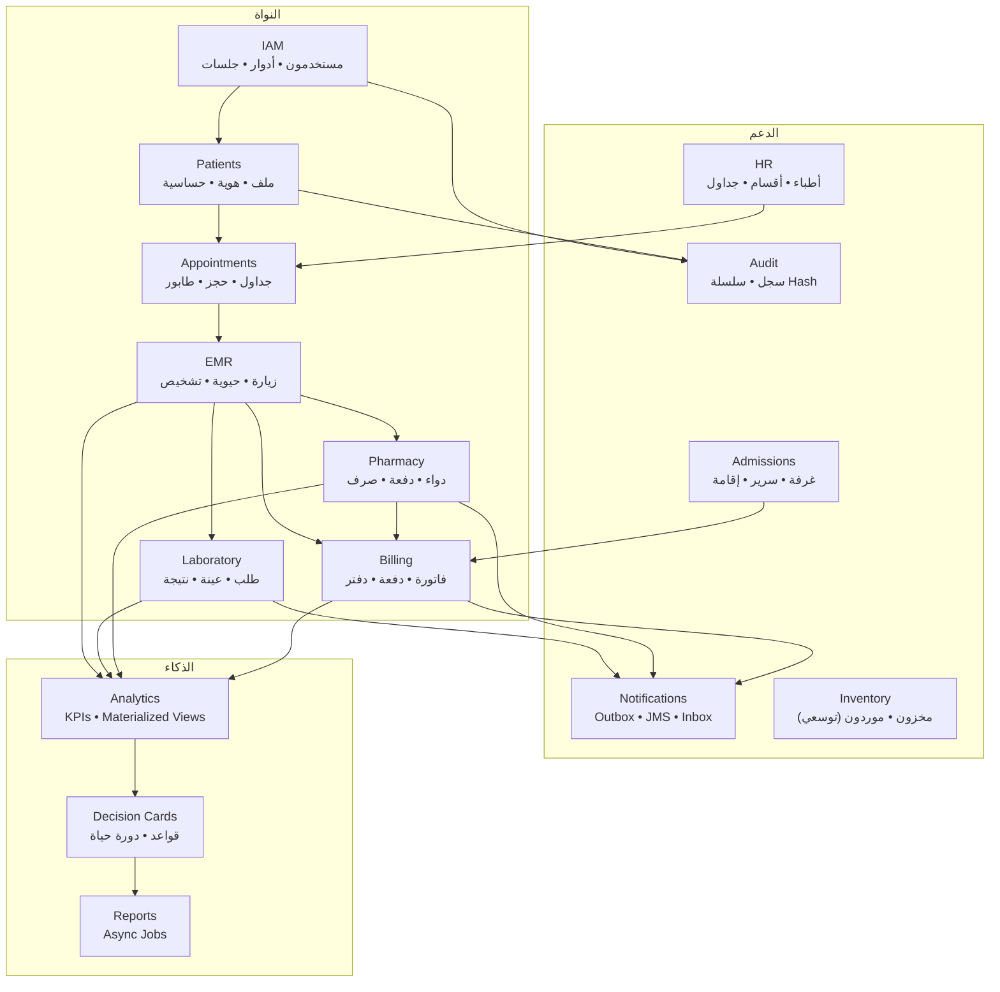
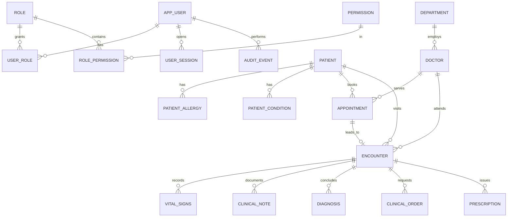
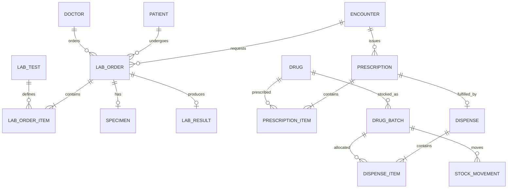
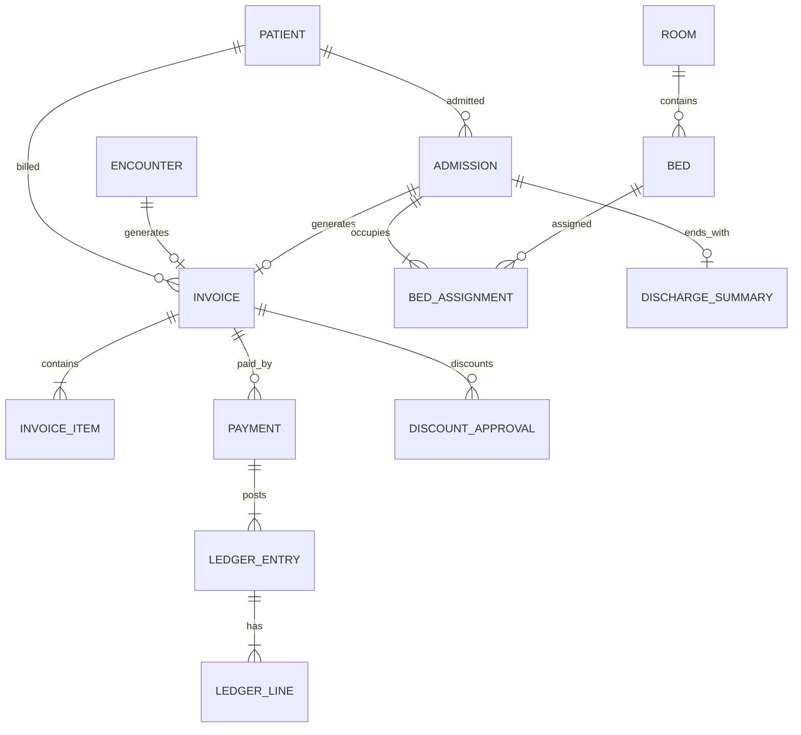

# 02 — المعمارية ونموذج البيانات

> **الغرض:** تعريف الحدود، والكيانات، والقيود، وأنماط المعاملات، وقواعد JPA، وعقد API.
> **المبدأ:** قاعدة البيانات تحمي الحقيقة، والخدمة تحمي العملية، والواجهة لا تقرر.

---

## 1. خريطة الوحدات (Module Map)



> كل سهم يعني **اعتماداً على واجهة أعمال**، وليس استدعاء جدول وحدة أخرى مباشرة. يجوز للتحليلات قراءة الجداول (Read Model) عبر Views، لكن لا يجوز لها الكتابة في جداول العمليات.

---

## 2. هيكل المشروع (Maven Multi-Module)

```text
smart-hospital/
├─ pom.xml                         # parent: dependencyManagement + plugins
├─ shared/                         # JAR: DTOs, enums, business interfaces, errors
│  └─ src/main/java/com/smarthospital/shared/...
├─ ejb/                            # EJB JAR: entities, repositories, services, MDB, schedulers
│  ├─ src/main/java/com/smarthospital/ejb/...
│  └─ src/main/resources/META-INF/persistence.xml
├─ web/                            # WAR: JAX-RS, filters, React static build
│  ├─ src/main/java/com/smarthospital/web/...
│  └─ src/main/webapp/
├─ ear/                            # EAR: packages shared + ejb + web
├─ frontend/                       # React + TS + Vite
├─ db/migration/                   # Flyway V1__...sql
├─ db/seed/                        # synthetic seed + demo reset
├─ scripts/                        # setup/deploy/backup/demo
└─ docs/
```

### مسؤوليات الوحدات

| الوحدة | تحتوي | لا تحتوي |
|--------|--------|-----------|
| `shared` | DTOs (records)، Enums، واجهات الخدمات، رموز الأخطاء، الثوابت | كيانات JPA، منطق أعمال |
| `ejb` | Entities، Repositories، Services (`@Stateless`)، `@Stateful`، `@Singleton`، MDB، `persistence.xml` | JAX-RS، HTML، React |
| `web` | Resources، Filters، ExceptionMappers، OpenAPI static، React build | منطق أعمال، استعلامات |
| `ear` | التجميع و`application.xml` | كود |

### الاعتماديات

```text
shared  ← ejb
shared  ← web
ejb     ← ear
web     ← ear
shared  ← ear
```

- `web` لا يعتمد على `ejb` في وقت الترجمة إن كانت واجهات الخدمات في `shared`.
- الحقن: `@EJB` على الواجهة المحلية.
- `jakarta.jakartaee-api` بنطاق `provided` في كل الوحدات.
- لا تضع سائق PostgreSQL داخل WAR؛ ضعه في `domain1/lib` أو في `ear/lib` حسب قرار النشر.

---

## 3. توزيع الحزم (Package by Feature)

```text
com.smarthospital.ejb
├─ common
│  ├─ audit/            AuditService, AuditAspect/Interceptor
│  ├─ security/         CurrentUser, PermissionService, PasswordHasher
│  ├─ outbox/           OutboxPublisher, OutboxEvent
│  ├─ config/           AppConfig (@Singleton)
│  ├─ error/            BusinessException, ConflictException, ForbiddenException
│  └─ util/             Clock, Money, Ids
├─ iam/                 entity, repo, service
├─ patient/
├─ appointment/
├─ encounter/
├─ lab/
├─ pharmacy/
├─ billing/
├─ admission/
├─ notification/
└─ analytics/
```

```text
com.smarthospital.web
├─ rest
│  ├─ v1/               PatientResource, AppointmentResource, ...
│  ├─ dto/              Request/Response models (إن لم تُشارك)
│  ├─ error/            ExceptionMappers (RFC 7807)
│  └─ filter/           AuthFilter, CsrfFilter, CorrelationFilter, AuditReadFilter
├─ security/            SessionService, CookieFactory, SecurityContextImpl
└─ bootstrap/           AppBootstrap, HealthResource
```

> **قاعدة:** لا حزمة `util` عامة مليئة بكل شيء. الأدوات لها أسماء domain-specific.

---

## 4. نموذج البيانات — نظرة دومينية

### 4.1 الكيانات الأساسية (حوالي 40 جدولاً)

#### IAM والأمان

| الجدول | الغرض | مفاتيح/قيود مهمة |
|--------|-------|-------------------|
| `app_user` | مستخدم | `username citext UNIQUE`, `email`, `password_hash`, `status`, `failed_attempts`, `locked_until`, `version` |
| `role` | دور | `code UNIQUE` (DOCTOR, NURSE...) |
| `permission` | صلاحية ذرية | `code UNIQUE` (patient.read, lab.approve...) |
| `role_permission` | ربط | PK(role_id, permission_id) |
| `user_role` | إسناد | PK(user_id, role_id, department_id?) + `valid_from/to` |
| `user_session` | جلسات | `token_hash UNIQUE`, `expires_at`, `revoked_at`, `ip`, `user_agent` |
| `login_attempt` | محاولات | `username`, `ip`, `success`, `occurred_at` |
| `audit_event` | تدقيق | `prev_hash`, `hash`, `payload jsonb`, append-only |
| `notification` | إشعار داخلي | `recipient_user_id`, `read_at`, `severity` |
| `outbox_event` | أحداث موثوقة | `event_id UNIQUE`, `status`, `attempts`, `next_attempt_at` |
| `processed_event` | منع التكرار | `event_id UNIQUE` |

#### المرضى والموارد البشرية

| الجدول | الغرض | مفاتيح/قيود |
|--------|-------|-------------|
| `patient` | مريض | `mrn UNIQUE`, `public_id UUID UNIQUE`, `national_id` فريد جزئي, `version` |
| `patient_identifier` | هويات إضافية | نوع/قيمة، فريد حسب النوع |
| `patient_allergy` | حساسية | `patient_id`, `substance`, `severity`, `verified` |
| `patient_condition` | مرض مزمن | `icd10_code`, `since`, `status` |
| `department` | قسم | `code UNIQUE` |
| `doctor` | طبيب | `user_id UNIQUE`, `license_no UNIQUE`, `department_id` |
| `doctor_schedule` | قالب دوام | `day_of_week`, `start_time`, `end_time`, `slot_minutes` |
| `doctor_leave` | إجازة | `start_date`, `end_date` |
| `room` | غرفة | `ward`, `class`, `daily_rate` |
| `bed` | سرير | `room_id`, `code UNIQUE`, `status` |

#### المواعيد والزيارات

| الجدول | الغرض | مفاتيح/قيود |
|--------|-------|-------------|
| `appointment` | موعد | `start_at/end_at`, `status`, `version` + **EXCLUDE** |
| `appointment_status_history` | تاريخ الحالات | من/إلى/بواسطة/وقت |
| `queue_ticket` | طابور | `priority`, `issued_at`, `called_at`, `status` |
| `encounter` | زيارة | `patient_id`, `doctor_id`, `type`, `started_at`, `ended_at`, `status` |
| `vital_signs` | علامات حيوية | قيم + نطاقات CHECK |
| `clinical_note` | ملاحظة | نوع + محتوى + توقيع |
| `diagnosis` | تشخيص | `icd10_code`, `type`, `certainty` |
| `clinical_order` | أمر طبي | نوع (LAB/RADIOLOGY/PROCEDURE) |
| `prescription` | وصفة | `status`, `expires_at`, `version` |
| `prescription_item` | بند | `drug_id`, `qty_prescribed`, `qty_dispensed` |

#### المختبر

| الجدول | الغرض | مفاتيح/قيود |
|--------|-------|-------------|
| `lab_test` | دليل الفحوص | `code UNIQUE`, `tat_target_minutes`, `price` |
| `lab_order` | طلب | `status`, `priority`, `ordered_at` |
| `lab_order_item` | بند | `result_value`, `unit`, `ref_low/high`, `flags` |
| `specimen` | عينة | `barcode UNIQUE`, `type`, `collected_at`, `received_at` |
| `lab_result` | نتيجة معتمدة | `result_hash`, `approved_by`, `approved_at` |
| `lab_reference_range` | نطاق مرجعي | حسب العمر/الجنس |

#### الصيدلية والمخزون

| الجدول | الغرض | مفاتيح/قيود |
|--------|-------|-------------|
| `drug` | دواء | `code UNIQUE`, `form`, `strength`, `controlled` |
| `drug_batch` | دفعة | `(drug_id, batch_no, expiry_date) UNIQUE`, `qty_on_hand >= 0` |
| `stock_movement` | حركة | `qty_delta`, `type`, append-only, `reference` |
| `dispense` | صرف | `prescription_id UNIQUE`, `idempotency_key UNIQUE` |
| `dispense_item` | بند صرف | `drug_batch_id`, `qty`, `unit_price` |
| `stock_alert` | تنبيه | نقص/انتهاء صلاحية |

#### الفواتير والمال

| الجدول | الغرض | مفاتيح/قيود |
|--------|-------|-------------|
| `service_catalog` | خدمة | `code`, `price`, `tax_rate`, `valid_from/to` |
| `invoice` | فاتورة | `status`, `total`, `paid_total`, `balance`, `version` |
| `invoice_item` | بند | لقطة سعر + كمية + خصم + ضريبة + مصدر |
| `payment` | دفعة | `receipt_no UNIQUE`, `idempotency_key UNIQUE`, `status` |
| `ledger_entry` | قيد | `entry_no UNIQUE`, `event_type`, `reference` |
| `ledger_line` | طرف القيد | `debit`, `credit`, `account_code` |
| `discount_approval` | خصم | مقدم/معتمد + سبب + حد |
| `refund` | استرجاع | مرتبط بدفعة أصلية + سبب |

#### التنويم

| الجدول | الغرض | مفاتيح/قيود |
|--------|-------|-------------|
| `admission` | إقامة | `patient_id`, `admitted_at`, `discharged_at`, `status` |
| `bed_assignment` | تخصيص | `bed_id`, `stay tstzrange` + **EXCLUDE** |
| `transfer` | نقل | من/إلى سرير + سبب |
| `discharge_summary` | ملخص خروج | تشخيص + توصيات + توقيع |

#### التحليلات

| الجدول | الغرض |
|--------|-------|
| `kpi_definition` | تعريف المؤشر: الصيغة، الوحدة، الهدف، الاتجاه، النسخة |
| `kpi_snapshot` | قيمة مؤشر لفترة/نطاق |
| `decision_card` | بطاقة قرار + دليل + ثقة + حالة |
| `decision_card_action` | إجراء/مالك/تاريخ/ملاحظة |
| `report_job` | مهمة تقرير غير متزامنة + تقدم + ملف |
| `data_quality_issue` | مشكلة جودة بيانات مكتشفة |

---

### 4.2 ERD — الأمان والمرضى والزيارة



### 4.3 ERD — المختبر والصيدلية



### 4.4 ERD — المال والتنويم



---

## 5. القيود الحاسمة (DDL مرجعي)

> هذه أمثلة تُنفّذ في Flyway. الأسماء النهائية تُطابق الكيانات.

### 5.1 منع تعارض المواعيد

```sql
-- يتطلب: CREATE EXTENSION btree_gist;
ALTER TABLE app.appointment
  ADD CONSTRAINT ex_appointment_doctor_time
  EXCLUDE USING gist (
    doctor_id WITH =,
    tstzrange(start_at, end_at, '[)') WITH &&
  )
  WHERE (status IN ('BOOKED', 'CONFIRMED', 'CHECKED_IN'));
```

- الموعد الملغى (`CANCELLED`) يخرج من القيد، فيمكن إعادة الحجز.
- لا تعتمد على `SELECT` ثم `INSERT` فقط؛ القيد هو الحكم النهائي.

### 5.2 منع تخصيص السرير مرتين

```sql
ALTER TABLE app.bed_assignment
  ADD CONSTRAINT ex_bed_assignment_period
  EXCLUDE USING gist (
    bed_id WITH =,
    tstzrange(assigned_at, released_at, '[)') WITH &&
  );
```

- `released_at = NULL` يعني إقامة مفتوحة (فترة غير محدودة علوياً).
- النقل يُغلق التخصيص القديم (`released_at = now()`) قبل إنشاء الجديد، في نفس المعاملة.

### 5.3 منع المخزون السالب

```sql
ALTER TABLE app.drug_batch
  ADD CONSTRAINT ck_batch_qty_nonnegative CHECK (qty_on_hand >= 0),
  ADD CONSTRAINT ck_batch_expiry CHECK (expiry_date > received_at::date);
```

### 5.4 منع تكرار الدفعة والصرف والدفع

```sql
ALTER TABLE app.drug_batch
  ADD CONSTRAINT uq_batch UNIQUE (drug_id, batch_no, expiry_date);

ALTER TABLE app.dispense
  ADD CONSTRAINT uq_dispense_prescription UNIQUE (prescription_id);

ALTER TABLE app.payment
  ADD CONSTRAINT uq_payment_idempotency UNIQUE (idempotency_key),
  ADD CONSTRAINT uq_payment_receipt UNIQUE (receipt_no);
```

### 5.5 قيود المال

```sql
ALTER TABLE app.invoice
  ADD CONSTRAINT ck_invoice_amounts CHECK (
    subtotal >= 0 AND discount_total >= 0 AND tax_total >= 0
    AND total >= 0 AND paid_total >= 0 AND balance >= 0
  );

ALTER TABLE app.ledger_line
  ADD CONSTRAINT ck_ledger_nonnegative CHECK (debit >= 0 AND credit >= 0),
  ADD CONSTRAINT ck_ledger_one_side CHECK (debit = 0 OR credit = 0),
  ADD CONSTRAINT ck_ledger_has_value CHECK (debit > 0 OR credit > 0);
```

### 5.6 منع تعديل/حذف سجل التدقيق وحركات المخزون

```sql
CREATE OR REPLACE FUNCTION app.deny_mutation() RETURNS trigger
LANGUAGE plpgsql AS $$
BEGIN
  RAISE EXCEPTION 'Append-only table: %', TG_TABLE_NAME;
END;
$$;

CREATE TRIGGER trg_audit_append_only
  BEFORE UPDATE OR DELETE ON app.audit_event
  FOR EACH ROW EXECUTE FUNCTION app.deny_mutation();

CREATE TRIGGER trg_stock_append_only
  BEFORE UPDATE OR DELETE ON app.stock_movement
  FOR EACH ROW EXECUTE FUNCTION app.deny_mutation();
```

> لا تمنح مستخدم التطبيق صلاحية `TRUNCATE` أو `ALTER` على هذه الجداول. استخدم مستخدم Migration منفصلاً إن أمكن.

### 5.7 الفهارس الأساسية

| الجدول | الفهرس | السبب |
|--------|--------|-------|
| `patient` | `lower(full_name_ar) gin_trgm_ops` | بحث عربي تقريبي |
| `patient` | `(phone)` | بحث استقبال |
| `patient` | `national_id` فريد جزئي `WHERE national_id IS NOT NULL` | منع تكرار الهوية |
| `appointment` | `(doctor_id, start_at)`, `(patient_id, start_at DESC)` | جداول الأطباء/المرضى |
| `encounter` | `(patient_id, started_at DESC)` | Timeline |
| `lab_order` | `(status, priority, ordered_at)` | Worklist |
| `lab_order_item` | `(lab_test_id)` | تقارير |
| `prescription` | `(status, issued_at)` | طابور الصيدلية |
| `drug_batch` | `(drug_id, expiry_date) WHERE qty_on_hand > 0` | FEFO |
| `stock_movement` | `(drug_id, occurred_at DESC)` | كارت الصنف |
| `invoice` | `(patient_id, issued_at DESC)`, `(status, due_at)` | كشوف/متابعة |
| `payment` | `(invoice_id)`, `(paid_at)` | توفيق |
| `audit_event` | `(occurred_at DESC)`, `(actor_user_id)`, `(patient_id)` | تحقيق |
| `notification` | `(recipient_user_id, read_at)` | Inbox |
| `outbox_event` | `(status, next_attempt_at)` | الناشر |

> قِس الاستعلامات بـ `EXPLAIN (ANALYZE, BUFFERS)` قبل إضافة فهارس عشوائية.

---

## 6. آلات الحالة (State Machines)

### 6.1 الوصفة

```text
DRAFT ──submit──> PENDING ──approve──> APPROVED ──dispense──> DISPENSED
  │                  │                    │                      │
  └──cancel──> CANCELLED                 │                 PARTIALLY_DISPENSED
                                         └──expire──> EXPIRED
```

### 6.2 طلب المختبر

```text
ORDERED ──collect──> COLLECTED ──receive──> RECEIVED ──start──> IN_PROGRESS
   │                     │                      │                    │
   │                     └──reject──> REJECTED  │                    ▼
   └──cancel──> CANCELLED                       └──────────────> RESULTED
                                                                     │
                                                              approve│
                                                                     ▼
                                                                 APPROVED
```

### 6.3 الفاتورة

```text
DRAFT ──issue──> OPEN ──partial payment──> PARTIALLY_PAID ──full──> PAID
                   │                              │
                   └──────────void────────────────┴──> VOID
```

### 6.4 التنويم

```text
REQUESTED ──allocate bed──> ADMITTED ──transfer──> ADMITTED (new bed)
                                │
                                └──discharge──> DISCHARGED
```

### 6.5 بطاقة القرار

```text
OPEN ──ack──> ACKNOWLEDGED ──plan──> ACTION_PLANNED ──resolve──> RESOLVED
  │                                                              │
  └──dismiss (reason)──> DISMISSED                    measure──> IMPACT_MEASURED
```

### 6.6 التنفيذ

- Enum في Java + `Map<Status, Set<Status>> ALLOWED` + method `transitionTo`.
- Service يتحقق قبل التغيير، ويكتب `status_history` + Audit.
- لا `setStatus` عاماً. لا `if` متفرقة في الواجهة.
- اختبار وحدة لكل انتقال مسموح ومرفوض.

---

## 7. أنماط المعاملات (Transaction Patterns)

### 7.1 صرف الدواء — قفل + FEFO + Rollback

```java
@Stateless
public class DispenseService {

  @PersistenceContext(unitName = "hospitalPU")
  private EntityManager em;

  @TransactionAttribute(TransactionAttributeType.REQUIRED)
  public DispenseResult dispense(Long prescriptionId, String idempotencyKey, Long actorId) {
    // 1) قفل الوصفة والتحقق من الحالة
    Prescription rx = em.find(Prescription.class, prescriptionId,
        LockModeType.PESSIMISTIC_WRITE,
        Map.of("jakarta.persistence.lock.timeout", 3000));

    if (rx == null) throw new NotFoundException("PRESCRIPTION_NOT_FOUND");
    rx.requireStatus(PrescriptionStatus.APPROVED);

    // 2) منع التكرار
    if (dispenseRepo.existsByPrescriptionId(prescriptionId)) {
      throw new ConflictException("ALREADY_DISPENSED");
    }

    // 3) لكل بند: تخصيص دفعات FEFO
    for (PrescriptionItem item : rx.getItems()) {
      int remaining = item.getQtyPrescribed() - item.getQtyDispensed();
      while (remaining > 0) {
        List<DrugBatch> batches = batchRepo.lockAvailableFefo(item.getDrugId(), remaining);
        if (batches.isEmpty()) throw new ConflictException("INSUFFICIENT_STOCK");

        for (DrugBatch batch : batches) {
          int take = Math.min(remaining, batch.getQtyOnHand());
          batch.take(take);                       // qty_on_hand -= take
          stockRepo.append(DISPENSE, batch, -take, ...);
          dispenseItemRepo.add(...);
          remaining -= take;
          if (remaining == 0) break;
        }
      }
    }

    // 4) الاعتماد والفاتورة والتدقيق في نفس المعاملة
    rx.markDispensed();
    billingService.addDispenseCharge(rx);
    auditService.record(...);

    return new DispenseResult(...);
  }
}
```

**استعلام FEFO:**

```sql
SELECT b.*
FROM app.drug_batch b
WHERE b.drug_id = :drugId
  AND b.qty_on_hand > 0
  AND b.expiry_date >= CURRENT_DATE
ORDER BY b.expiry_date ASC, b.id ASC
FOR UPDATE SKIP LOCKED;
```

- `SKIP LOCKED` يمنع انتظار صفوف مقفلة من مستخدم آخر.
- إن لم تكفِ الدفعات → استثناء → كل التغييرات تتراجع.
- `idempotency_key` يمنع إعادة الصرف عند إعادة إرسال الطلب.

### 7.2 الدفع — Idempotency + دفتر مزدوج

```java
@TransactionAttribute(TransactionAttributeType.REQUIRED)
public PaymentReceipt pay(Long invoiceId, BigDecimal amount,
                          String idempotencyKey, PaymentMethod method, Long actorId) {

  // إعادة الطلب بنفس المفتاح = نفس النتيجة
  Optional<Payment> existing = paymentRepo.findByIdempotencyKey(idempotencyKey);
  if (existing.isPresent()) return mapper.toReceipt(existing.get());

  Invoice invoice = em.find(Invoice.class, invoiceId, LockModeType.PESSIMISTIC_WRITE);
  invoice.requirePayable();
  if (amount.signum() <= 0) throw new ValidationException("AMOUNT_POSITIVE");
  if (amount.compareTo(invoice.getBalance()) > 0) throw new ConflictException("OVERPAYMENT");

  Payment payment = paymentRepo.insert(invoice, amount, method, idempotencyKey, actorId);
  ledgerService.postPayment(payment);       // debit CASH / credit AR
  invoice.applyPayment(amount);             // paid_total, balance
  auditService.record(...);

  return mapper.toReceipt(payment);
}
```

**قيود الحماية:** `UNIQUE(idempotency_key)` + `CHECK(balance >= 0)` + قفل الفاتورة.

> ⚠️ **تفصيل حاسم:** لا تنفّذ `exists` ثم `insert` لمفتاح Idempotency. تحت التزامن، الخيطان يمران من `exists` ثم يفشل أحدهما بقيد UNIQUE، وفي PostgreSQL **يُجهض التحقق كامل المعاملة** (لا يمكنك التقاط الاستثناء ومتابعة العمل).
> استخدم إدراجاً ذرّياً:
>
> ```sql
> INSERT INTO app.payment (..., idempotency_key)
> VALUES (..., :key)
> ON CONFLICT (idempotency_key) DO NOTHING
> RETURNING id;
> ```
>
> إذا لم يُعِد صفاً، اجلب الدفعة الموجودة وأعد إيصالها. نفس المبدأ ينطبق على `dispense` و`processed_event`.

### 7.3 Outbox — لا تُرسل قبل الحفظ

```java
@Singleton
@Startup
public class OutboxPublisher {

  @Resource(lookup = "jms/HospitalConnectionFactory")
  private ConnectionFactory cf;

  @Resource(lookup = "jms/NotificationQueue")
  private Queue queue;

  @PersistenceContext(unitName = "hospitalPU")
  private EntityManager em;

  @Schedule(second = "*/10", minute = "*", hour = "*", persistent = false)
  @Lock(LockType.WRITE)
  @TransactionAttribute(TransactionAttributeType.REQUIRES_NEW)
  public void publishBatch() {
    List<OutboxEvent> batch = outboxRepo.claimBatch(50); // FOR UPDATE SKIP LOCKED
    for (OutboxEvent event : batch) {
      try (JMSContext ctx = cf.createContext()) {
        ctx.createProducer()
           .setDeliveryMode(DeliveryMode.PERSISTENT)
           .send(queue, event.getPayload());
        event.markPublished();
      } catch (JMSException e) {
        event.markFailed(e.getMessage());        // retry with backoff
      }
    }
  }
}
```

- إذا انهار التطبيق بعد `send` وقبل `markPublished` → إعادة إرسال → **MDB يتجاهل التكرار** عبر `processed_event`.
- إذا كان الوسيط متوقفاً → الحدث يبقى `NEW/FAILED` ويعاد لاحقاً.
- حفظ النتيجة الطبية لا ينتظر JMS أبداً.

```java
@MessageDriven(activationConfig = {
  @ActivationConfigProperty(propertyName = "destinationLookup",
                            propertyValue = "jms/NotificationQueue"),
  @ActivationConfigProperty(propertyName = "destinationType",
                            propertyValue = "jakarta.jms.Queue")
})
public class LabNotificationMdb implements MessageListener {
  @TransactionAttribute(TransactionAttributeType.REQUIRED)
  public void onMessage(Message message) {
    String eventId = message.getStringProperty("eventId");
    // INSERT ... ON CONFLICT (event_id) DO NOTHING RETURNING id
    // إذا لم يُعِد صفاً → الرسالة مكررة، تجاهلها.
    if (!processedEventRepo.tryInsert(eventId)) return; // idempotent
    notificationService.createForDoctor(...);
  }
}
```

### 7.4 التدقيق: معاملة الأعمال مقابل حدث الأمان

| النوع | المعاملة | مثال |
|-------|----------|------|
| Business Audit | نفس معاملة العملية (`REQUIRED`) | صرف دواء، اعتماد نتيجة، دفعة |
| Security Audit | معاملة جديدة (`REQUIRES_NEW`) | فشل دخول، وصول مرفوض، Break-glass |

> **تحذير EJB:** استدعاء method بنفس الكائن لا يطبق `@TransactionAttribute`. ضع أحداث الأمان في Bean منفصل (`SecurityAuditService`) لضمان `REQUIRES_NEW`.

### 7.5 الأقفال والاستثناءات

| الحالة | الاستجابة |
|--------|-----------|
| `OptimisticLockException` | `409` برمز `CONCURRENT_UPDATE` + رسالة "أعد التحميل" |
| `PessimisticLockException` / timeout | `409` أو `423` برمز `RESOURCE_BUSY` |
| `SQLIntegrityConstraintViolationException` | `409` مع رمز domain (تعارض/تكرار) |
| استثناء غير متوقع | `500` + `traceId` فقط، بلا StackTrace للعميل |

- لا تعِد المحاولة تلقائياً على الدفع أو الصرف إلا بمفتاح Idempotency.
- أعد المحاولة فقط على أخطاء transient (deadlock/serialization) وبحد أقصى 3.

---

## 8. قواعد JPA والأداء

### 8.1 الضبط

```xml
<persistence-unit name="hospitalPU" transaction-type="JTA">
  <jta-data-source>jdbc/hospitalDS</jta-data-source>
  <shared-cache-mode>ENABLE_SELECTIVE</shared-cache-mode>
  <properties>
    <property name="eclipselink.target-database" value="PostgreSQL"/>
    <property name="eclipselink.ddl-generation" value="none"/>
    <property name="eclipselink.logging.level" value="INFO"/>
    <property name="eclipselink.logging.logger" value="JavaLogger"/>
    <property name="eclipselink.jdbc.batch-writing" value="JDBC"/>
    <property name="eclipselink.jdbc.batch-writing.size" value="100"/>
  </properties>
</persistence-unit>
```

### 8.2 قواعد إلزامية

1. **لا `findAll()`** في endpoint. كل قائمة: `page`, `size` (حد أقصى 100), `sort` ضمن allowlist.
2. **DTO Projections** للقوائم. لا تُرجع Entity.
3. **EntityGraph / JOIN FETCH** لشاشات التفاصيل فقط.
4. **`@BatchFetch(BatchFetchType.IN)`** للمجموعات المتعددة.
5. **Second-level cache** للبيانات المرجعية فقط (أدوية، فحوص، خدمات) وبمراجعة.
6. **`@Version`** على الكيانات القابلة للتعديل المتزامن (مريض، وصفة، فاتورة، إقامة).
7. **`read-only` hint** للتقارير.
8. **لا Open Session in View**. حدود المعاملة تنتهي في Service.
9. **لا استعلام داخل حلقة**. اجلب دفعة واحدة.
10. **اختبر N+1** بعدّ الاستعلامات في اختبار تكامل.

### 8.3 التقسيم والقياس

- عشرة ملايين حركة مخزون ليست واقعاً أكاديمياً، لكن صمّم كأنها كذلك: فهارس، Keyset pagination للتدقيق، وتقسيم شهري اختياري لـ `audit_event` و`stock_movement`.
- فعّل `pg_stat_statements` وراجع أبطأ 20 استعلاماً قبل التسليم.
- استخدم `EXPLAIN (ANALYZE, BUFFERS)` في تقرير الأداء.

---

## 9. عقد API

### 9.1 الاتفاقيات

| العنصر | القاعدة |
|--------|---------|
| Base | `/api/v1` |
| المصادر | جمع، أسماء domain: `/patients`, `/appointments`, `/lab-orders` |
| العمليات | أفعال صريحة: `POST /prescriptions/{id}/dispense`, `POST /lab-orders/{id}/approve` |
| الترقيم | `?page=0&size=20&sort=createdAt,desc` |
| الاستجابة | `{ content, page, size, totalElements, totalPages }` |
| الأخطاء | RFC 7807: `type, title, status, detail, code, messageAr, messageEn, traceId, fieldErrors` |
| التواريخ | ISO-8601 مع منطقة زمنية (`2026-11-09T10:15:30+07:00`) |
| المال | سلسلة عشرية + عملة (`"amount": "125000.00", "currency": "IDR"`) |
| Idempotency | رأس `Idempotency-Key` للدفع/الصرف/الاعتماد |
| التزامن | `ETag`/`If-Match` أو `version` في الجسم |
| الملفات | `202 Accepted` + `jobId` + `Location: /reports/jobs/{id}` |

### 9.2 مثال خطأ

```json
{
  "type": "https://smarthospital.local/errors/insufficient-stock",
  "title": "Insufficient stock",
  "status": 409,
  "code": "INSUFFICIENT_STOCK",
  "messageAr": "الكمية المتاحة من الدواء غير كافية لإتمام الصرف.",
  "messageEn": "Insufficient stock to complete dispensing.",
  "traceId": "b1e7c0f2...",
  "fieldErrors": []
}
```

### 9.3 OpenAPI

- احتفِظ بملف `openapi/openapi.yaml` كعقد واحد (Spec-first).
- ولّد أنواع TypeScript: `npx openapi-typescript openapi/openapi.yaml -o frontend/src/api/schema.d.ts`.
- اختبار عقد في CI: كل endpoint موجود في المواصفة، والأمثلة صالحة.
- وثّق كل عملية بأمثلة نجاح/فشل.

---

## 10. الترحيل والبيانات

### 10.1 Flyway

```text
db/migration/
├─ V1__iam_core.sql
├─ V2__patients_hr.sql
├─ V3__appointments.sql
├─ V4__emr.sql
├─ V5__lab.sql
├─ V6__pharmacy_inventory.sql
├─ V7__billing.sql
├─ V8__admissions.sql
├─ V9__analytics.sql
└─ V10__audit_outbox.sql
```

- لا تعدّل ملف migration بعد تطبيقه؛ أضف `V11__...`.
- `ddl-generation=none` دائماً.
- طبّق الترحيل عبر Maven/CI قبل النشر، أو `@Singleton` بقفل `pg_advisory_lock` (إن أردت التلقائي).
- اختبر migrations على قاعدة فارغة **و** على نسخة من بيانات العرض.

### 10.2 البيانات الاصطناعية

- 12 شهراً من البيانات، بذرة عشوائية ثابتة (`seed=42`).
- 2,000–5,000 مريض، 20,000 موعد، 10,000 زيارة، 30,000 طلب مختبر، 100,000 حركة مخزون.
- أنماط واقعية: ذروة صباحية، أيام أسبوع، مواسم، نسبة عدم حضور 8–12%، تأخير مختبر.
- **لا بيانات مرضى حقيقية**، ولا أسماء مشاهير، ولا أرقام هواتف حقيقية.
- سكربت `demo-reset` يعيد الحالة إلى سيناريو عرض معروف خلال دقيقة.

---

## 11. المهام الخلفية (Background Jobs)

| المهمة | التوقيت | القفل | المخرج |
|--------|---------|--------|--------|
| Outbox Publisher | كل 10 ثوان | `@Lock(WRITE)` | إرسال الأحداث |
| No-show Marker | كل ساعة | Singleton | تحديث المواعيد |
| Bed Charge Accrual | يومياً 00:10 | Singleton + DB lock | بنود فواتير |
| KPI Snapshot | يومياً 01:00 | Singleton | `kpi_snapshot` |
| Decision Cards | يومياً 01:30 | Singleton | بطاقات جديدة |
| Data Quality Monitor | يومياً 02:00 | Singleton | مشاكل |
| Report Worker | عند الطلب | `@Asynchronous` | ملف + حالة |
| Session Cleanup | كل ساعة | Singleton | حذف المنتهية |
| Audit Chain Verify | أسبوعياً | Singleton | تقرير سلامة |

- استخدم `@Singleton` + `@Lock(LockType.WRITE)` لمنع التداخل داخل العقدة.
- في بيئة متعددة العقد، استخدم `pg_try_advisory_lock` إضافياً.
- كل مهمة تكتب `job_run` (بداية/نهاية/حالة/مدة/صفوف) لتشخيص واضح.

---

## 12. الواجهة الأمامية (React)

| الجانب | القرار |
|--------|--------|
| Build | Vite + TypeScript strict |
| Routing | React Router (BrowserRouter) + SPA fallback filter |
| Data | TanStack Query (cache, retry, invalidation) |
| Forms | React Hook Form + Zod |
| UI | Tailwind + مكونات محلية، RTL أولاً، خط عربي واضح |
| Auth | Cookie جلسة + CSRF header، لا Token في LocalStorage |
| Errors | Toast + Error Boundary + Problem Details |
| Tables | Server-side pagination/sorting/filtering |
| A11y | Keyboard, focus ring, labels, contrast, `dir="rtl"` |
| i18n | `ar` افتراضي + `en` تقني، أرقام/تواريخ `Intl` |
| API types | مولدة من OpenAPI |

### الصفحات الأساسية

- Login / تغيير كلمة المرور / Break-glass.
- Reception: بحث مريض، تسجيل، مواعيد اليوم، تسجيل وصول، طابور.
- Doctor: جدولي، ملف المريض (Timeline)، حيوية، تشخيص، طلبات، وصفات، نتائج.
- Nurse: طابور التriage، علامات حيوية، مهام.
- Lab: Worklist، عينة، إدخال نتيجة، اعتماد، Critical alerts.
- Pharmacy: طابور وصفات، معالج صرف FEFO، مخزون، صلاحية.
- Cashier: فاتورة، دفعة، إيصال، استرجاع.
- Manager: KPIs، بطاقات قرار، تقارير، What-if.
- Admin: مستخدمون/أدوار، أطباء/جداول، كتالوجات، إعدادات.
- Auditor: بحث تدقيق، تحقق السلسلة، سجل الوصول.

---

## 13. المراقبة والتشغيل

- **Correlation ID**: Filter يقرأ/يولّد `X-Request-Id`، يضعه في كل سجل ويرجعه في الاستجابة.
- **Logs**: JSON أو Key-Value، بلا PII، مع `userId`, `traceId`, `action`, `durationMs`.
- **Health**: `/api/v1/health` يفحص DB (`SELECT 1`)، ويُعيد `UP/DEGRADED/DOWN`.
- **Metrics** (اختياري): عدد الطلبات، زمن الاستجابة، أخطاء 4xx/5xx، عمق طابور JMS، مهام فاشلة.
- **Job Run Table**: كل مهمة خلفية لها سجل.
- **Backup**: يومي + قبل كل عرض + تجربة استعادة موثقة.
- **Secrets**: JNDI/متغيرات بيئة، لا `.env` في Git.

---

## 14. قائمة تحقق المعمارية

- [ ] كل خدمة `@Stateless` وحدود معاملة واضحة.
- [ ] لا Entity في API.
- [ ] كل قائمة مُصفّحة.
- [ ] كل عملية حساسة لها Audit.
- [ ] كل حالة لها State Machine.
- [ ] كل تعارض زمني له قيد DB.
- [ ] كل عملية قابلة لإعادة الإرسال لها Idempotency.
- [ ] كل إشعار يمر بـ Outbox.
- [ ] كل جدول مالي/مخزون append-only أو محمي.
- [ ] `persistence.xml` بلا `ddl-generation`.
- [ ] لا استعلام داخل حلقة.
- [ ] `EXPLAIN ANALYZE` موثق لأهم 10 استعلامات.
- [ ] OpenAPI محدث ومولّد للواجهة.
- [ ] Health + Correlation + Logs تعمل.
- [ ] Flyway يبني قاعدة فارغة بنجاح.
