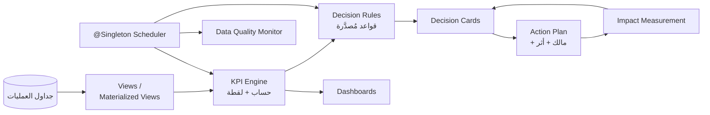

# 04 — الذكاء التشغيلي ودعم القرار

> **الوعد:** لا رسوم بيانية بلا قرار، ولا قرار بلا دليل، ولا دليل بلا نافذة زمنية وثقة وافتراضات.
> **الحد:** تشغيل فقط. لا تشخيص، لا علاج، لا تغيير قرار طبيب.

---

## 1. المستويات الأربعة داخل Smart Hospital

| المستوى | السؤال | التطبيق | مثال |
|---------|--------|---------|------|
| Descriptive | ماذا حدث؟ | مؤشرات مجمعة + اتجاهات | متوسط الانتظار، الإشغال، الإيراد |
| Diagnostic | لماذا حدث؟ | تفكيك المؤشر حسب المرحلة/القسم/الوقت | عنق زجاجة في سحب العينة |
| Predictive | ماذا قد يحدث؟ | Seasonal Naive + فاصل ثقة + Backtest | توقع arrivals 7 أيام |
| Prescriptive | ماذا نفعل؟ | توصيات تشغيلية بخيارات وأثر متوقع | إضافة تغطية في الذروة |

> **ليست ذكاءً اصطناعياً.** هي **إحصاء + قواعد + تفسير**. هذا أقوى أكاديمياً لأن كل رقم قابل للدفاع.

---

## 2. المعمارية



### المكونات

| المكون | التقنية | المسؤولية |
|--------|---------|-----------|
| Read Models | SQL Views + Materialized Views | تجميع سريع وقابل للتفسير |
| KPI Registry | `kpi_definition` | تعريف واحد للمؤشر، بلا ازدواج |
| KPI Snapshots | `kpi_snapshot` | تاريخ يومي/أسبوعي للمقارنة |
| Rule Engine | Java + قواعد مُصدَّرة | توليد بطاقات، بلا سحر |
| Decision Cards | `decision_card` + actions | المشكلة/الدليل/التوصية/الأثر |
| Report Jobs | `report_job` + `@Asynchronous` | تقارير ثقيلة بلا حجب |
| DQ Monitor | SQL checks + جدول | كشف الفساد قبل أن يكبر |
| Forecast | Java/SQL | توقع بسيط + Backtest |

> **لا تحسب المؤشرات في Java بجلب كل الصفوف.** احسبها في SQL، واجلب النتيجة الصغيرة إلى Java.

---

## 3. قاموس المؤشرات (KPI Dictionary)

كل مؤشر له: كود، تعريف رياضي، مصدر، نافذة، وحدة، اتجاه، هدف، مالك، نسخة.

| الكود | المؤشر | الصيغة | الهدف (مثال) | المصدر |
|-------|--------|--------|--------------|--------|
| `WAIT_REG_TO_DOCTOR_P90` | انتظار التسجيل→الطبيب (p90) | `percentile_cont(0.9)` لفرق `encounter.started_at - appointment.checked_in_at` | ≤ 45 دقيقة | appointment/encounter |
| `WAIT_TRIAGE_P90` | انتظار التriage (p90) | `started_at - checked_in_at` | ≤ 15 دقيقة | queue |
| `NO_SHOW_RATE` | عدم الحضور | `no_show / (scheduled - cancelled)` | ≤ 10% | appointment |
| `BED_OCCUPANCY` | إشغال الأسرّة | `bed_days_occupied / bed_days_available` | 75–85% | bed_assignment |
| `ALOS` | متوسط مدة الإقامة | `sum(discharge - admit) / discharges` | حسب القسم | admission |
| `LAB_TAT_P50/P90` | زمن تحول المختبر | `approved_at - ordered_at` | ≤ 120 دقيقة روتيني | lab_order |
| `LAB_TAT_STAGE` | زمن كل مرحلة | فرق الطوابع الزمنية | تُحدد لكل فحص | lab |
| `LAB_CRITICAL_NOTIFY` | زمن إبلاغ القيمة الحرجة | `notification.created_at - approved_at` | ≤ 15 دقيقة | lab/notification |
| `RX_TURNAROUND` | زمن الصرف | `dispensed_at - approved_at` | ≤ 30 دقيقة | prescription |
| `STOCKOUT_RATE` | نفاد | `drug_days_zero / drug_days_total` | ≤ 2% | drug_batch |
| `EXPIRY_WASTE_VALUE` | قيمة الهدر من الصلاحية | `sum(qty_expired × unit_cost) / stock_value` | ≤ 1% | drug_batch |
| `COLLECTION_RATE` | التحصيل | `payments / billed` | ≥ 95% | payment/invoice |
| `AR_DAYS` | أيام الذمم | `AR / (revenue / 30)` | ≤ 30 يوم | invoice |
| `REVENUE_LEAKAGE` | تسرب الإيراد | عدد/قيمة الأحداث القابلة للفوترة بلا بند | 0 | encounter/lab/pharmacy |
| `READMISSION_30D` | إعادة تنويم 30 يوماً | `readmits / discharges` | ≤ 5% | admission |
| `DOCTOR_UTILIZATION` | استغلال الطبيب | `consult_minutes / available_minutes` | 70–85% | appointment |
| `DATA_QUALITY_ISSUES` | مشاكل جودة البيانات | عدد مفتوح حسب النوع | 0 حرج | dq |

### قواعد التعريف

1. **نافذة زمنية صريحة** (`from`, `to`, `timezone=Asia/Jakarta`).
2. **عينة صريحة** (`sample_size`) — لا مؤشر بلا عدد حالات.
3. **اتجاه** (`HIGHER_IS_BETTER` / `LOWER_IS_BETTER`) — لتلوين الاتجاه بلا لبس.
4. **هدف قابل للتهيئة** لكل قسم/فترة.
5. **نسخة** (`version`) — تغيير الصيغة لا يغيّر التاريخ بصمت.
6. **لا خلط بيانات ناقصة** — إذا كانت الجودة < 90%، اعرض التحذير.

---

## 4. بطاقة القرار (Decision Card)

### 4.1 البنية

| الحقل | الوصف |
|-------|-------|
| `code` | نوع البطاقة (`WAIT_TIME_HIGH`, `LAB_TAT_BOTTLENECK`...) |
| `severity` | `INFO / LOW / MEDIUM / HIGH / CRITICAL` |
| `scope_type/id` | قسم، دواء، سرير، طبيب، مريض؟ (تشغيلي فقط) |
| `period_start/end` | نافذة التحليل |
| `metric_code` | المؤشر المرتبط |
| `observed_value` / `threshold` / `baseline` | الأرقام |
| `evidence` | JSON: السلاسل، المقارنات، المراحل، العينات |
| `analysis` | نص مولّد من قالب + أرقام |
| `recommendation` | توصية تشغيلية (خيارات، لا أوامر) |
| `expected_impact` | أثر متوقع + كيف يُقاس |
| `confidence` | 0–100 + سبب |
| `assumptions` | افتراضات صريحة |
| `status` | OPEN → ... → IMPACT_MEASURED |
| `owner_user_id`, `due_at` | المسؤول والموعد |
| `dedupe_key` | يمنع تكرار البطاقة المفتوحة |
| `rule_version` | reproducibility |

### 4.2 دورة الحياة

```text
OPEN
 ├─ acknowledge (مدير) ──> ACKNOWLEDGED
 │      ├─ plan (إجراء + مالك + موعد) ──> ACTION_PLANNED
 │      │        ├─ resolve (ملاحظة) ──> RESOLVED
 │      │        │        └─ measure (14 يوماً) ──> IMPACT_MEASURED
 │      │        └─ reopen ──> OPEN
 │      └─ dismiss (سبب إلزامي) ──> DISMISSED
 └─ auto-expire (نافذة انتهت) ──> EXPIRED
```

### 4.3 قواعد التوليد (أمثلة قابلة للتهيئة)

| القاعدة | الشرط | الشدة | التوصية |
|---------|-------|-------|---------|
| `WAIT_TIME_HIGH` | p90 > الهدف لـ 3 أيام متتالية في قسم | HIGH | إعادة توزيع مواعيد/تغطية إضافية في الذروة |
| `LAB_TAT_BOTTLENECK` | p90 > 1.5× الهدف لـ 7 أيام، ومرحلة معينة تمثل > 50% من الزمن | MEDIUM | معالجة عنق الزجاجة (سحب/استلام/اعتماد) |
| `LAB_CRITICAL_DELAY` | زمن إبلاغ > 15 دقيقة أو وصول غير مؤكد | CRITICAL | تصعيد فوري + مراجعة مسار الإشعار |
| `STOCK_BELOW_REORDER` | `qty_on_hand < reorder_point` أو أيام تغطية < 7 | HIGH | أمر شراء/تحويل بين الأقسام |
| `EXPIRY_RISK` | قيمة دفعات تنتهي خلال 30/60/90 يوماً > حد | MEDIUM | FEFO/تحويل/إرجاع مورد |
| `OCCUPANCY_PROJECTED` | إشغال متوقع 7 أيام > 92% | HIGH | إدارة خروج/أسرّة إضافية/تحويل |
| `REVENUE_LEAKAGE` | زيارة/طلب/صرف مكتمل بلا بند فاتورة | HIGH | إنشاء بند/مراجعة دورة الفوترة |
| `NO_SHOW_SPIKE` | المعدل > الأساس + 2σ | MEDIUM | تذكير/سياسة إعادة جدولة |
| `INVOICE_MISMATCH` | `paid_total != sum(payments)` أو دفتر غير متوازن | CRITICAL | إيقاف التوفيق ومراجعة مالية |
| `NEGATIVE_STOCK` | أي كمية سالبة | CRITICAL | تحقيق فوري + إصلاح حركة |
| `BREAK_GLASS_ABUSE` | > 3 استخدامات/7 أيام لمستخدم | MEDIUM | مراجعة أمنية |
| `DRUG_INTERACTION_OVERRIDE` | نسبة تجاوز التحذيرات > 10% | MEDIUM | مراجعة بروتوكول/تدريب |

### 4.4 منع إرهاق التنبيهات

- `dedupe_key = code + scope + period` مع قيد فريد للبطاقات المفتوحة.
- حد أقصى بطاقات/يوم لكل نطاق (مثلاً 3).
- دمج البطاقات المتشابهة في بطاقة واحدة بأدلة متعددة.
- لا تنبيه بلا إجراء ممكن.
- `severity` تحدد القناة: CRITICAL = إشعار فوري + بريد (اختياري)؛ MEDIUM = Inbox.

### 4.5 الثقة (Confidence)

```text
score = 90
- 20 إذا n < 30
- 15 إذا نسبة البيانات الناقصة > 5%
- 15 إذا معامل الاختلاف CV > 0.5
- 10 إذا النافذة < 7 أيام
- 10 إذا كان المصدر غير مكتمل (مثلاً لا توجد نتائج معتمدة)
clamp(30, 95)
```

- تُعرض مع سبب مختصر: "ثقة متوسطة: العينة 18 حالة فقط".
- لا بطاقة CRITICAL بثقة < 60 دون مراجعة بشرية.

### 4.6 قياس الأثر

```
baseline = المؤشر في 14 يوماً قبل الإجراء
post     = المؤشر في 14 يوماً بعد الحل
delta    = post - baseline
delta_%  = delta / baseline
```

- قارن نفس مزيج أيام الأسبوع إن أمكن.
- اذكر العوامل المربكة (موسم، عطلة، تغيير طبيب).
- إن لم تتوفر بيانات كافية: "غير قابل للقياس" — لا تختلق رقماً.
- الأثر يُعرض في البطاقة وفي لوحة "قيمة القرارات".

### 4.7 بطاقة مثال (Wait Time)

```json
{
  "code": "WAIT_TIME_HIGH",
  "severity": "HIGH",
  "scope": { "type": "DEPARTMENT", "id": 12, "name": "الباطنية" },
  "period": { "from": "2026-10-27", "to": "2026-11-02" },
  "metric": "WAIT_REG_TO_DOCTOR_P90",
  "observed": 68,
  "threshold": 45,
  "baseline": 41,
  "evidence": {
    "daily_p90": [40, 42, 55, 61, 68, 72, 66],
    "arrivals": [88, 91, 120, 132, 140, 136, 118],
    "doctor_hours": [6, 6, 6, 6, 5, 5, 6],
    "peak_hours": ["09:00-11:00"]
  },
  "analysis": "ارتفع p90 من 41 إلى 68 دقيقة خلال 7 أيام، بالتزامن مع زيادة الوصول 38% دون زيادة ساعات الأطباء.",
  "recommendation": "تجربة إضافة تغطية طبيب في 09:00-11:00 لمدة أسبوعين، أو إعادة توزيع 20% من المواعيد إلى فترة ما بعد الظهر.",
  "expected_impact": "خفض p90 بمقدار 12-18 دقيقة إذا ثبتت نسبة الوصول.",
  "confidence": 78,
  "assumptions": [
    "بيانات تسجيل الوصول مكتملة",
    "لا تغيير في مزيج الحالات",
    "الزيادة ليست بسبب عطلة رسمية"
  ]
}
```

---

## 5. التوقعات (Predictive)

### 5.1 توقع الوصول اليومي

**الطريقة:** Seasonal Naive + Moving Average.

```text
y_hat(t) = 0.6 × avg(نفس يوم الأسبوع في آخر 4 أسابيع)
         + 0.4 × avg(آخر 7 أيام)

interval = y_hat ± 1.96 × std(residuals)
```

- بسيط، قابل للتفسير، ولا يحتاج تدريباً.
- **Backtest:** آخر 28 يوماً، احسب MAE وMAPE والانحياز.
- اعرض "التوقع ±" وليس رقماً واحداً.
- إذا MAPE > 25% → لا تعرض توصية، اعرض "بيانات غير كافية".

### 5.2 توقع الإشغال

```text
projected(t) = current_census
             + scheduled_admissions
             - expected_discharges(t)

expected_discharges(t) = الحالات المتوقع خروجها بناءً على توزيع ALOS للقسم
```

- اعرض نطاقاً (متفائل/متوقع/متشائم).
- لا تعِد تنويم مريض لم يُسجَّل.

### 5.3 مخاطر عدم الحضور

نموذج درجات قابل للتفسير (Heuristic Score):

```text
score = 0.40 × تاريخ عدم الحضور للمريض (0-1)
      + 0.25 × مهلة الحجز (أيام)
      + 0.20 × يوم الأسبوع/الوقت
      + 0.15 × مريض جديد
```

- النطاقات: منخفض < 30، متوسط 30–60، مرتفع > 60.
- التوصية: تذكير مكثف/تأكيد، لا إلغاء آلي.
- وثّق أن هذا **تقدير تشغيلي** وليس حكماً على المريض.

### 5.4 What-if (Prescriptive)

**حاسبة السعة:**

```text
required_doctors = ceil( arrivals_per_hour × avg_consult_minutes / 60 / target_utilization )
```

مثال: 20 مريضاً/ساعة × 15 دقيقة / 60 / 0.8 = 6.25 → 7 أطباء.

- اعرض الافتراضات: مدة الاستشارة، التوزيع، فترات الراحة.
- اعرض الخيارات: طبيب إضافي، تمديد ساعات، تحويل مرضى، تقليل no-show.
- لا تنفّذ تغييراً تلقائياً.

---

## 6. كشف تسرب الإيرادات (Revenue Leakage)

### القواعد

| الحالة | الاكتشاف |
|--------|----------|
| زيارة مكتملة بخدمة قابلة للفوترة بلا `invoice_item` | `NOT EXISTS` |
| صرف دواء بلا بند فاتورة | `dispense` بلا `invoice_item(source_type='DISPENSE')` |
| نتيجة مختبر معتمدة بلا بند | `lab_order` معتمد بلا بند |
| إقامة منتهية بلا احتساب أيام | `admission.discharged_at` بلا بنود سرير |
| دفعة بلا قيد دفتر | `payment` بلا `ledger_entry` |
| فاتورة `paid_total` لا يساوي مجموع الدفعات | توفيق |

### العرض

- قائمة حالات + قيمة + عمر + المسؤول.
- بطاقة قرار واحدة مجمعة إذا تجاوزت الحد.
- زر "إنشاء بند" مع تدقيق، لا تعديل صامت.

---

## 7. مراقبة جودة البيانات

| الفحص | الشدة | الإجراء |
|-------|-------|---------|
| مخزون سالب | CRITICAL | إيقاف الصرف للدواء + تحقيق |
| دفعة منتهية بكمية > 0 | HIGH | حجز/إتلاف + تنبيه |
| فاتورة غير متوازنة | CRITICAL | مراجعة مالية |
| دفتر غير متوازن (مدين ≠ دائن) | CRITICAL | إيقاف التوفيق |
| موعد متعارض (Legacy) | HIGH | مراجعة/إصلاح |
| نتيجة بلا عينة | HIGH | منع الاعتماد |
| مريض مكرر محتمل | MEDIUM | مراجعة دمج |
| مستخدم بلا دور | MEDIUM | تعطيل/إسناد |
| سلسلة تدقيق مكسورة | CRITICAL | تحقيق أمني |
| صرف بلا فاتورة | HIGH | بطاقة تسرب |

- كل فحص يُنتج `data_quality_issue` مع `first_seen`, `last_seen`, `count`, `sample_ids`.
- لا تحذف المشكلة تلقائياً؛ أغلقها بعد الإصلاح مع دليل.

---

## 8. البيانات الاصطناعية (Synthetic Data)

### لماذا؟

بدون بيانات واقعية، كل التحليلات أرقام صغيرة أو مسطحة. البيانات الاصطناعية تجعل العرض مقنعاً وتحمي الخصوصية.

### المواصفات

| العنصر | القيمة |
|--------|--------|
| الفترة | 12 شهراً |
| المرضى | 3,000 |
| الأطباء | 40 في 8 أقسام |
| المواعيد | 25,000 |
| الزيارات | 12,000 |
| طلبات المختبر | 30,000 |
| الوصفات | 18,000 |
| حركات المخزون | 120,000 |
| الفواتير | 10,000 |
| البذرة | `seed=42` (نتائج قابلة للتكرار) |

### أنماط يجب بناؤها

- ذروة صباحية (08:00–11:00) وأيام أسبوع.
- 8–12% عدم حضور.
- تأخير مختبر في قسم/فحص محدد لآخر 14 يوماً (لإنشاء بطاقة TAT).
- دواءان تحت حد إعادة الطلب، ودفعة تنتهي خلال 30 يوماً.
- 5–10 زيارات مكتملة بلا بند فاتورة (لإنشاء بطاقة تسرب).
- تباين إشغال 60–95% مع اتجاه صاعد في آخر أسبوع.
- 3 استخدامات Break-glass لمستخدم واحد (لاختبار البطاقة الأمنية).

> **قاعدة:** كل بطاقة قرار في العرض يجب أن يكون لها سبب بيانات واضح، وليس "لأننا برمجناها".

---

## 9. الواجهة

### لوحة المدير

- 8 بطاقات KPI: الاتجاه، الهدف، العينة، آخر تحديث.
- فلترة: الفترة، القسم، النوع.
- Drill-down: من الرقم إلى السلسلة إلى الحالات.
- زر "لماذا؟" يشرح الصيغة والافتراضات.

### صندوق بطاقات القرار

- ترتيب حسب الشدة والعمر.
- فلاتر: مفتوحة/مخططة/محلولة، النطاق، المالك.
- تفاصيل: الأدلة (رسم + جدول)، التحليل، التوصية، الثقة، الافتراضات، خطة الإجراء، الأثر.
- إجراءات: إقرار، خطة، حل، رفض بسبب، إعادة فتح.

### مركز التقارير

- إنشاء تقرير → `202` + `jobId`.
- شريط تقدم/حالة.
- تنزيل CSV/PDF عند الاكتمال.
- انتهاء صلاحية الملف بعد 7 أيام.

### جودة البيانات

- عدد المشاكل حسب النوع/الشدة.
- عينة معرفات (بلا PII غير ضروري).
- إجراء إصلاح/إغلاق.

---

## 10. API مختصر

| الطريقة | المسار | الوصف |
|---------|--------|-------|
| GET | `/api/v1/analytics/kpis?from&to&departmentId` | قيم KPI |
| GET | `/api/v1/analytics/kpis/{code}/series` | سلسلة زمنية |
| GET | `/api/v1/analytics/forecast/arrivals?departmentId&days=7` | توقع + فاصل |
| GET | `/api/v1/analytics/what-if?departmentId&arrivalsDelta&doctors` | محاكاة |
| GET | `/api/v1/decision-cards?status&severity` | صندوق |
| POST | `/api/v1/decision-cards/{id}/acknowledge` | إقرار |
| POST | `/api/v1/decision-cards/{id}/plan` | خطة |
| POST | `/api/v1/decision-cards/{id}/resolve` | حل |
| POST | `/api/v1/decision-cards/{id}/dismiss` | رفض بسبب |
| POST | `/api/v1/reports` | تقرير غير متزامن |
| GET | `/api/v1/reports/jobs/{id}` | حالة |
| GET | `/api/v1/reports/jobs/{id}/download` | تنزيل |
| GET | `/api/v1/data-quality/issues` | مشاكل |

---

## 11. أدوات التقييم (كيف نعرف أن الذكاء ناجح؟)

| المقياس | التعريف | الهدف |
|---------|---------|-------|
| Alert Precision | بطاقات تم اتخاذ إجراء لها / إجمالي البطاقات | ≥ 60% |
| Time to Acknowledge | زمن من الإنشاء إلى الإقرار | < 24 ساعة للحرج |
| Resolution Rate | بطاقات محلولة / مفتوحة | ≥ 70% |
| Measured Impact Rate | بطاقات قُيس أثرها / محلولة | ≥ 50% |
| Forecast MAPE | متوسط خطأ النسبة المئوية | ≤ 20% |
| KPI Freshness | عمر آخر لقطة | < 24 ساعة |
| DQ Critical Open | مشاكل حرجة مفتوحة | 0 |
| Card Fatigue | بطاقات/نطاق/أسبوع | ≤ 3 |

> اعرض هذه الأرقام في لوحة "صحة النظام التحليلي". المشروع الذي يقيس ذكاءه أكثر إقناعاً من الذي يدّعيه.

---

## 12. الحدود الأخلاقية والتنظيمية

1. **لا تشخيص آلي** ولا توصية علاجية.
2. **لا قرار آلي** في التوظيف/التقييم/القبول/الفواتير؛ التوصية بشرية.
3. **لا PII** في التحليلات المجمعة، ومنع الخلايا < 5.
4. **الشفافية:** كل بطاقة تعرض الدليل والفترة والافتراضات والثقة.
5. **العدالة:** لا تستخدم الجنس/العمر/الجنسية لتقييم فرد؛ يمكن استخدامها فقط لاكتشاف فجوات وصول مجمعة.
6. **الاحتفاظ:** بيانات التحليلات المجمعة أطول من التفاصيل، مع سياسة واضحة.
7. **المراجعة:** كل قاعدة لها مالك ونسخة وتاريخ اعتماد.
8. **الاستثناء البشري:** يمكن رفض أي توصية بسبب موثق.

---

## 13. ما لا يجب فعله

- ❌ لوحة ألوان بلا هدف أو نافذة.
- ❌ "AI" بلا تعريف أو تقييم.
- ❌ توقع بلا Backtest.
- ❌ بطاقة بلا إجراء أو مالك.
- ❌ تنبيهات متكررة بلا Dedupe.
- ❌ قياس أثر بلا خط أساس.
- ❌ استخدام بيانات مريض حقيقية.
- ❌ الخلط بين المؤشر التشغيلي والقرار السريري.
