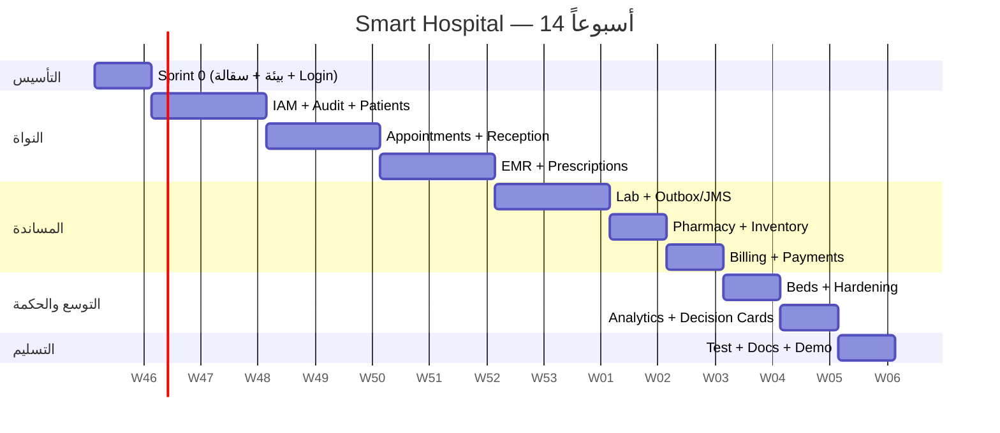

# 06 — خارطة التنفيذ (14 أسبوعاً)

> **الافتراض:** فريق من 3 أشخاص (Backend، Frontend، Full-stack/QA) بمعدل 15–20 ساعة أسبوعياً، ومشرف دوري.
> **إن كنت منفرداً:** اضرب المدة × 1.7 أو اقتصر على `Must` دون `Should`.
> **القاعدة:** كل أسبوع ينتهي بشيء يعمل، وليس بشريحة كود نصف مكتملة.

---

## 1. المراحل في صورة واحدة



> التواريخ إرشادية. عدّلها حسب بداية فصلكم.

---

## 2. Sprint 0 — الأسبوع 1: التأسيس

### الهدف

بيئة تعمل، مشروع ينشر، تسجيل دخول كامل من React إلى PostgreSQL، وسجل تدقيق.

### المهام

| المجال | المهمة | المخرج |
|--------|--------|--------|
| بيئة | تدقيق وتثبيت JDK/Maven/PG/GF | `01-ENVIRONMENT.md` منفذ |
| قاعدة بيانات | إنشاء DB/role/schema/extensions | `smart_hospital` + `app` |
| GF | Pool + JNDI + JMS + سيكيوريتي | موارد تعمل |
| Maven | Parent + shared/ejb/web/ear | بناء نظيف |
| DB | Flyway V1 (IAM) + V2 (Audit) | ترحيل ناجح |
| Backend | `AppUser`, `Role`, `Permission`, `UserSession`, `AuditEvent` | كيانات + repositories |
| Backend | `AuthService` (Argon2) + `SessionService` + `AuditService` | Login/Logout/Me |
| Web | `AuthFilter`, `CsrfFilter`, `CorrelationFilter`, `ExceptionMapper` | 401/403/409 منظمة |
| Web | `/api/v1/health` | 200 |
| Frontend | Vite + Tailwind + RTL + Router + Query | هيكل |
| Frontend | Login + Logout + Guard + Layout | يعمل |
| CI | بناء Backend + Frontend | أول Pipeline |
| Docs | ADR-01..05 + OpenAPI v0 | موثق |

### بوابة الخروج

- [ ] تسجيل دخول ناجح من React، وجلسة تُحفظ في Cookie.
- [ ] `GET /auth/me` يعيد المستخدم والصلاحيات.
- [ ] `POST` بلا CSRF → 403.
- [ ] كل دخول/خروج في `audit_event`.
- [ ] `mvn verify` و`npm run build` ينجحان.
- [ ] الـ EAR ينشر على GF.

---

## 3. Sprint 1 — الأسابيع 2–3: IAM + المرضى

### الهدف

إدارة مستخدمين وأدوار وصلاحيات، وتسجيل مرضى بلا تكرار، وتدقيق كامل.

### Backend

- CRUD مستخدمين + تعطيل/تفعيل + إعادة تعيين كلمة مرور مؤقتة.
- إسناد أدوار (مع قسم اختياري).
- `@RequiresPermission` + `CurrentUser` + `PatientAccessPolicy`.
- `Patient`: MRN تلقائي، `public_id`، هوية وطنية، هاتف، عنوان، جهة اتصال طارئ.
- كشف تكرار: exact على national_id/phone + تشابه اسم (trgm).
- `PatientAllergy`, `PatientCondition`.
- تدقيق قراءة/تغيير + أحداث أمان `REQUIRES_NEW`.
- اختبارات: 403، تكرار، تدقيق.

### Frontend

- شاشة مستخدمين/أدوار (Admin).
- قائمة مرضى + بحث + Pagination.
- تسجيل/تعديل مريض + تحقق Zod.
- ملف مريض (نظرة عامة، حساسية، أمراض).
- Empty/Loading/Error states.

### قاعدة البيانات

- `V2__patients.sql` + فهارس trgm + قيود فريدة.
- Seed أدوار/صلاحيات + مستخدم Admin.

### بوابة الخروج

- [ ] استقبال ينشئ مريضاً ويجده بالبحث.
- [ ] مريض مكرر بنفس الهوية → 409 مع اقتراح.
- [ ] طبيب لا يرى مريضاً غير مرتبط (403 + Audit).
- [ ] Admin لا يمنح نفسه دوراً سريرياً (403).
- [ ] كل تغيير مريض له Audit.

---

## 4. Sprint 2 — الأسابيع 4–5: المواعيد والاستقبال

### الهدف

جدول طبيب، حجز بلا تعارض، تسجيل وصول، طابور بأولوية.

### Backend

- `Doctor`, `Department`, `DoctorSchedule`, `DoctorLeave`.
- توليد slots من القالب مع استثناء الإجازات.
- `Appointment` + `EXCLUDE` constraint + تحقق من الماضي/الإجازة.
- إعادة جدولة/إلغاء + `status_history`.
- `check-in` + `QueueTicket` (EMERGENCY > ELDERLY > APPOINTMENT > WALK_IN).
- Job: mark no-show.
- اختبار تزامن 20 طلباً على نفس اللوت.

### Frontend

- إدارة أطباء/أقسام/جداول (Admin/Manager).
- شاشة حجز: اختيار مريض → طبيب → slot.
- يوم الاستقبال: قائمة، check-in، طابور، نداء.
- عرض التعارض برسالة عربية واضحة.

### بوابة الخروج

- [ ] 20 حجزاً متزامناً على نفس اللوت → 1 فقط.
- [ ] إلغاء موعد يحرر اللوت.
- [ ] check-in ينشئ تذكرة طابور بترتيب صحيح.
- [ ] لا حجز في الماضي/إجازة.
- [ ] اختبار تزامن موثق في التقرير.

---

## 5. Sprint 3 — الأسابيع 6–7: EMR والوصفات

### الهدف

زيارة طبية كاملة: حيوية، ملاحظات، تشخيص، أوامر، وصفة، وإغلاق.

### Backend

- `Encounter` + `VitalSigns` + `ClinicalNote` + `Diagnosis`.
- التحقق من النطاقات الفسيولوجية (CHECK + Bean Validation).
- `ClinicalOrder` (LAB/RADIOLOGY/PROCEDURE).
- `Prescription` + items + state machine + تحقق الحساسية/التكرار (تحذير).
- `@Stateful` لمعالج الوصفة/الفاتورة (اختياري لكن مطلوب أكاديمياً): `PrescriptionDraftBean` مع `@Remove` وtimeout.
- صلاحيات الطبيب/الممرضة + ABAC.
- Timeline للمريض.

### Frontend

- قائمة زيارات اليوم للطبيب.
- شاشة زيارة: حيوية (رسم بسيط)، ملاحظات، تشخيصات، طلبات، وصفة.
- إغلاق الزيارة + قفل التعديل.
- واجهة ممرضة: triage + حيوية.
- عرض تحذير الحساسية/التفاعل مع سبب التجاوز.

### بوابة الخروج

- [ ] زيارة كاملة من الحجز إلى الإغلاق.
- [ ] وصفة تُنشأ بحالة `PENDING` ثم `APPROVED`.
- [ ] ممرضة لا تعتمد تشخيصاً نهائياً.
- [ ] طبيب لا يعدل زيارة مغلقة.
- [ ] Timeline تعرض الأحداث بالترتيب.

---

## 6. Sprint 4 — الأسابيع 8–9: المختبر + JMS

### الهدف

طلب → عينة → نتيجة → اعتماد → إشعار، مع إثبات أن فشل الإشعار لا يفقد النتيجة.

### Backend

- `LabTest`, `LabOrder`, `LabOrderItem`, `Specimen`, `LabResult`, `ReferenceRange`.
- State machine + timestamps لكل مرحلة (TAT).
- `abnormal_flag` و`critical_flag`.
- فصل الاعتماد: `approved_by != resulted_by`.
- `outbox_event` + `OutboxPublisher` + `LabNotificationMdb` + `processed_event`.
- `notification` inbox + API.
- اختبار: JMS متوقف → النتيجة محفوظة.
- اختبار: رسالة مكررة → إشعار واحد.

### Frontend

- Worklist مختبر (filters/status/priority).
- استلام عينة + إدخال نتيجة + اعتماد (Supervisor).
- Critical alert modal.
- Inbox إشعارات للطبيب + عداد.

### بوابة الخروج

- [ ] نتيجة معتمدة تظهر في ملف المريض.
- [ ] إشعار للطبيب خلال 10 ثوانٍ (أو عند تشغيل الناشر).
- [ ] إيقاف JMS لا يمنع الحفظ.
- [ ] إعادة تشغيل الناشر لا تكرر الإشعار.
- [ ] اعتماد من نفس المدخل → 403.

---

## 7. Sprint 5 — الأسبوع 10: الصيدلية والمخزون

### الهدف

صرف FEFO بذرّية، مخزون لا يسالب، وتنبيهات نقص/صلاحية.

### Backend

- `Drug`, `DrugBatch`, `StockMovement`, `Dispense`, `DispenseItem`, `StockAlert`.
- استعلام FEFO + `FOR UPDATE SKIP LOCKED`.
- صرف كامل/جزئي + Idempotency.
- استلام دفعة + تسوية + إرجاع.
- تنبيه نقص/صلاحية (Job).
- اختبار آخر 10 وحدات + فشل بند ثانٍ.

### Frontend

- طابور وصفات.
- معالج صرف: عرض الدفعات FEFO، الكميات، التكلفة.
- مخزون: بحث، دفعات، صلاحية، تنبيهات.
- استلام دفعة (Inventory).

### بوابة الخروج

- [ ] صرفان متزامنان لا ينتجان مخزوناً سالباً.
- [ ] وصفة ببند ناقص → لا خصم لأي بند.
- [ ] الدفعة الأقرب انتهاءً تُخصص أولاً.
- [ ] دفعة منتهية لا تُصرف.
- [ ] إعادة الطلب بنفس المفتاح → لا صرف ثانٍ.

---

## 8. Sprint 6 — الأسبوع 11: الفواتير والمدفوعات

### الهدف

فاتورة ببنود، دفعة بإيصال، دفتر مزدوج، توفيق.

### Backend

- `ServiceCatalog` (سعر قابل للتهيئة).
- `Invoice`, `InvoiceItem`, `Payment`, `LedgerEntry`, `LedgerLine`.
- إنشاء فاتورة من زيارة/صرف/مختبر/إقامة.
- دفع + Idempotency + إيصال.
- إلغاء/استرجاع بقيد عكسي.
- خصم بموافقة.
- Job توفيق + DQ mismatch.
- اختبار دفعتين متزامنتين + مفتاح مكرر.

### Frontend

- فاتورة قابلة للعرض/الطباعة.
- شاشة دفع + إيصال.
- كشف حساب مريض.
- خصم مع سبب/موافقة.
- تقرير مالي أساسي.

### بوابة الخروج

- [ ] `paid_total` و`balance` صحيحان بعد دفعات متعددة.
- [ ] دفعة زائدة → 409.
- [ ] إعادة نفس المفتاح → إيصال واحد.
- [ ] إلغاء دفعة → قيد عكسي، لا حذف.
- [ ] دفتر متوازن (مدين = دائن).

---

## 9. Sprint 7 — الأسبوع 12: الأسرّة + التحصين

### الهدف

تنويم بلا تعارض، ثم إغلاق الثغرات قبل التحليلات.

### Backend

- `Room`, `Bed`, `Admission`, `BedAssignment` + `EXCLUDE`.
- تخصيص/نقل/خروج + احتساب إقامة.
- Job احتساب ليلي.
- مراجعة الصلاحيات (كل endpoint).
- تحسين استعلامات القوائم.
- رؤوس أمان + CSP + Secure cookie profile.
- اختبار استعادة + backup.

### Frontend

- خريطة أسرّة (شبكة/حالات).
- تنويم/نقل/خروج.
- لوحة إشغال بسيطة.

### بوابة الخروج

- [ ] 10 تخصيصات متزامنة لنفس السرير → 1.
- [ ] نقل يغلق القديم ويفتح الجديد.
- [ ] خروج ينشئ بنود إقامة.
- [ ] كل endpoint له صلاحية.
- [ ] فحص أمني أساسي أخضر.

---

## 10. Sprint 8 — الأسبوع 13: التحليلات وبطاقات القرار

### الهدف

8–10 مؤشرات، 4–6 بطاقات، تقارير غير متزامنة، بيانات اصطناعية.

### Backend

- Materialized Views + `kpi_definition` + `kpi_snapshot`.
- حساب 8–10 KPIs.
- Rule engine + `decision_card` + actions.
- Job ليلي + dedupe + confidence.
- `report_job` + `@Asynchronous` + CSV/PDF.
- DQ monitor + revenue leakage.
- Seed 12 شهراً + demo reset.

### Frontend

- لوحة مدير + فلاتر + Drill-down.
- صندوق بطاقات + تفاصيل + إجراءات.
- مركز تقارير + تقدم.
- صفحة جودة بيانات.

### بوابة الخروج

- [ ] كل KPI له تعريف/عينة/نافذة.
- [ ] 4 بطاقات تُولد من بيانات العرض بأدلة.
- [ ] دورة بطاقة كاملة (إقرار → خطة → حل → قياس).
- [ ] تقرير 50k صف لا يحجب الواجهة.
- [ ] `demo-reset` يعيد الحالة في < 60 ثانية.

---

## 11. Sprint 9 — الأسبوع 14: الاختبار والتسليم

### المهام

| اليوم | المهمة |
|-------|--------|
| 1 | تشغيل A1–A28 + S1–S20 وإصلاح |
| 2 | اختبار أداء 100 VU + توثيق |
| 3 | اختبار استعادة + RTO/RPO |
| 4 | توثيق API/User Manual/دليل تشغيل |
| 5 | بروفة العرض + فيديو احتياطي |
| 6 | تنظيف Git + Tag v1.0 + تسليم |

### بوابة الخروج النهائية

- [ ] كل Must يعمل.
- [ ] كل معايير القبول خضراء.
- [ ] الأداء ضمن الهدف.
- [ ] التوثيق كامل.
- [ ] عرض 15 دقيقة + سيناريو 10 دقائق.
- [ ] مستودع نظيف بلا أسرار/بيانات حقيقية.

---

## 12. Definition of Ready / Done

### Ready (قبل بدء القصة)

- [ ] قصة مستخدم + معايير قبول.
- [ ] تصميم API (مسار/طلب/استجابة/أخطاء).
- [ ] حقول البيانات والقيود.
- [ ] الصلاحيات المطلوبة.
- [ ] تصميم واجهة أو وصف واضح.
- [ ] بيانات اختبار.

### Done (قبل إغلاق القصة)

- [ ] كود مراجَع (PR).
- [ ] Unit + Integration tests.
- [ ] صلاحيات + Audit.
- [ ] معالجة أخطاء + رسائل عربية.
- [ ] API موثق في OpenAPI.
- [ ] واجهة تعمل على 1366×768 و1920×1080.
- [ ] Pagination/Validation.
- [ ] لا N+1 جديد.
- [ ] Seed/demo data.
- [ ] تحديث الوثائق.

---

## 13. Git وسير العمل

```text
main        ← إصدارات مستقرة فقط (tags)
develop     ← تكامل يومي
feature/*   ← قصة واحدة
fix/*       ← إصلاح
hotfix/*    ← نادر
```

- Conventional Commits: `feat(lab): add result approval`, `fix(billing): prevent overpayment`.
- PR صغير (< 400 سطر إن أمكن) + وصف + لقطات + اختبار.
- لا دمج مباشر إلى `main`.
- حماية `main` و`develop` + CI إلزامي.
- Tag: `v0.1` (Sprint 0)، `v0.2` ... `v1.0`.
- `.gitignore`: `target/`, `node_modules/`, `dist/`, `.env`, `*.log`, `backup/`, `.idea/`, `*.dump`.

---

## 14. توزيع الجهد (تقدير)

| الحزمة | شخص-يوم |
|--------|---------|
| Sprint 0 | 8 |
| IAM + Audit | 12 |
| Patients | 6 |
| Appointments | 10 |
| EMR | 10 |
| Lab + JMS | 12 |
| Pharmacy/Inventory | 14 |
| Billing | 12 |
| Beds | 7 |
| Analytics/Cards/Reports | 14 |
| Hardening/Docs/Demo | 10 |
| **الإجمالي** | **~115–125** |

- فريق 3 × 14 أسبوعاً × 3.5 يوم فعلي ≈ 147 يوماً → هامش معقول.
- منفرد: 24–28 أسبوعاً، أو اقتصر على 7 وحدات Must.

---

## 15. خطة التقليص إن تأخرت

| الأولوية | ماذا تُبقي؟ | ماذا تؤجل؟ |
|----------|-------------|-------------|
| 1 | IAM, Patients, Appointments, EMR, Lab, Pharmacy, Billing | — |
| 2 | Outbox + Audit + 6 KPIs + 2 Cards | Beds, Reports, DQ |
| 3 | Beds, 8 KPIs, 4 Cards | Procurement, HR متقدم |
| 4 | كل `Should` | — |

> **لا تؤجل أبداً:** قيود التعارض، صلاحيات 403، Rollback، Audit، Idempotency. هذه هي التي تُقيَّم.

---

## 16. خطة العرض (10–12 دقيقة)

| الدقيقة | المشهد | الرسالة |
|---------|--------|---------|
| 0–1 | المشكلة والنطاق | لماذا نظام مؤسسي؟ |
| 1–3 | استقبال: تسجيل + حجز + محاولة تعارض | منع التعارض في DB |
| 3–5 | طبيب: زيارة + حيوية + طلب مختبر + وصفة | دورة علاج موثقة |
| 5–6 | مختبر: نتيجة + اعتماد + إشعار | JMS + فصل واجبات |
| 6–7 | صيدلية: صرف + محاولة نفاد | FEFO + Rollback |
| 7–8 | محاسب: دفعة + إعادة إرسال | Idempotency + دفتر |
| 8–9 | تنويم: سرير + تعارض | قيد زمني |
| 9–10 | مدير: KPI + بطاقة قرار | ذكاء قابل للتفسير |
| 10–11 | مدقق: سلسلة Hash + وصول مرفوض | أمان وتدقيق |
| 11–12 | فشل JMS ثم تعافٍ | موثوقية |

### خطة بديلة

- فيديو مسجل للسيناريو الكامل.
- بيانات `demo` جاهزة + `demo-reset`.
- لقطات شاشة لكل خطوة.
- نسخة احتياطية من قاعدة العرض.

---

## 17. خريطة التقنيات إلى جلسات المقرر

| الجلسة | التقنية | أين تُعرض؟ |
|--------|---------|-------------|
| 1 | EJB Architecture | EAR + `@Stateless` services |
| 2 | Stateless / Stateful | `DispenseService` / `PrescriptionDraftBean` |
| 3 | Singleton & Concurrency | `OutboxPublisher`, schedulers, `@Lock` |
| 4 | Dependency Injection | `@EJB`, `@Inject`, `@Resource` |
| 5 | JPA Fundamentals | Entities + mappings |
| 6 | Advanced Mapping | Patient/Encounter/Prescription/Lab |
| 7 | EntityManager & Query API | Repositories + projections + Criteria |
| 8 | JPA Optimization | `@BatchFetch`, EntityGraph, cache, indexes |
| 9 | JMS & MDB | Lab notification |
| 10 | Asynchronous | Reports + `@Asynchronous` + `@Schedule` |
| 11 | Security & Transactions | RBAC/ABAC + CMT + rollback + locks |
| 12 | Best Practices | Tests, ADRs, observability, troubleshooting |

> في المناقشة، لا تقل "استخدمت JMS" فقط. قل: "النتيجة تُحفظ في معاملة، والحدث يُكتب في Outbox، والناشر يرسل، وMDB يتجاهل التكرار؛ لذلك فشل الوسيط لا يفقد النتيجة". هذا هو الفرق.

---

## 18. مخرجات كل أسبوع (Deliverables)

| الأسبوع | التسليم |
|---------|---------|
| 1 | EAR ينشر + Login + Audit + CI |
| 2–3 | IAM + Patients + شاشاتهم + تقرير اختبار |
| 4–5 | Appointments + Reception + اختبار تزامن |
| 6–7 | EMR + Prescriptions + Timeline |
| 8–9 | Lab + Outbox/JMS + Inbox |
| 10 | Pharmacy + FEFO + Stock alerts |
| 11 | Billing + Payments + Ledger |
| 12 | Beds + Hardening + Backup drill |
| 13 | Analytics + Cards + Reports + Seed |
| 14 | Test report + Docs + Demo + Tag v1.0 |

---

## 19. إيقاع الفريق

- **الاثنين:** تخطيط الأسبوع + اختيار القصص.
- **يومياً:** 15 دقيقة: أمس/اليوم/عوائق.
- **الخميس:** مراجعة كود + دمج.
- **الجمعة:** عرض 10 دقائق + تحديث `develop` + tag إن لزم.
- **كل أسبوعين:** Retro: ما نجح؟ ما نغيّره؟
- **لوحة مهام:** Epics → Stories → Tasks، مع عمود "Blocked".

---

## 20. معيار النجاح النهائي

> في العرض، يجب أن يقول أحد أعضاء اللجنة: **"هذا النظام يمنع الخطأ، ولا يكتفي بعرضه."**

إن استطعت إثبات:
1. تعارض موعد/سرير مرفوض تحت التزامن.
2. صرف ناقص يتراجع بالكامل.
3. نتيجة مختبر تنجو من فشل الإشعار.
4. دفعة مكررة لا تُخصم مرتين.
5. وصول غير مصرح مرفوض ومسجل.
6. بطاقة قرار لها دليل وثقة وأثر.

فقد تجاوزت مشروع "CRUD" إلى **نظام مؤسسي**.
